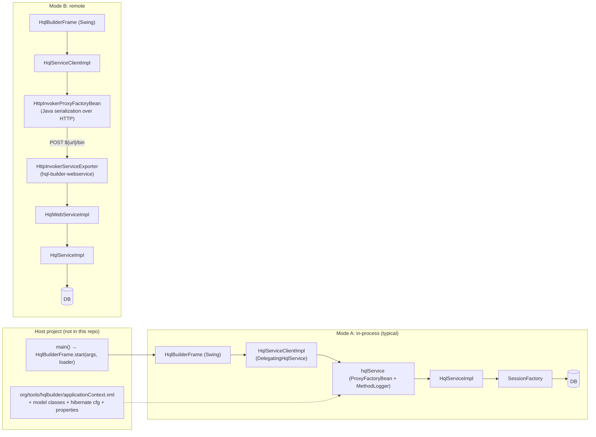

# 01: Current architecture (as-is)

This is a snapshot of the code at commit `278fddca`. It describes what the web migration has to
replace or reuse.

> The host-project bootstrap in §3 (a host project providing `applicationContext.xml` and a `main`)
> stays the way the **Swing** client is started. The web version replaces it with an environment
> folder: `lib/` plus `hqlbuilder.properties`, `db.properties` and `security.properties`, mounted into
> a container ([11-docker-packaging.md](11-docker-packaging.md)). It reuses the same service context
> XML (§3, item 3). §3.1 shows a real host project and 11 §5 maps it onto the new configuration.

## 1. Repository layout

```
<git root>/
├── .github/workflows/        build.yml (mvn verify, JDK 17), maven.yml (package -DskipTests), codeql.yml, stale.yml
├── other/                    helper scripts for downloading dependencies
├── web-migration/            this plan
└── hql-builder/              Maven root: groupId org.tools.hql-builder, artifactId bom, 6.0.6-SNAPSHOT
    ├── hql-builder-interfaces/    DTOs shared by everything: ExecutionResult, QueryParameter, ValidationException, Information
    ├── hibernate/                 one adapter per Hibernate version: hibernate-5.4, -5.5, -5.6 (default), -6.0
    │                              (RunQuery, RunSqlQuery, QueryTranslator, MetadataResolver, Lucene InformationImpl, ...)
    ├── spring/                    dependency bundles: hibernate5-spring-orm, hibernate6-spring-orm
    ├── hql-builder-annotations/   annotation processors (hibernate cfg / jaxb.index generation)
    ├── hql-builder-common/        HqlService interface, QueryParameters, HibernateWebResolver, GroovyCompiler,
    │                              exceptions, DelegatingHqlService, EntityRelationHelper, icons (~1000 png), logback cfg
    ├── hql-builder-service/       HqlServiceImpl (the actual engine), Spring XML context, LocalSessionFactoryBeanPlus5
    ├── hql-builder-client/        Swing UI: HqlBuilderFrame, PropertyPanel, ObjectTree, HqlWizard, favorites, i18n bundles
    ├── hql-builder-web/           (only with -P inc-web-modules) webcommon, webservice, webclient: legacy REST/HttpInvoker
    └── hql-builder-full/          NOT in the reactor; stale (references non-existent modules)
```

The default reactor (`hql-builder/pom.xml` `<modules>`) contains interfaces, hibernate, spring,
annotations, common, service and client. The `hibernate-${version.hibernate}` adapter is selected by
the property `version.hibernate` (default `5.6`) and pulled in as an `optional` dependency.

## 2. Tech stack and versions

| Area | Version / library | Source |
|---|---|---|
| Java | 17 (`targetJdk.short`) | root pom |
| Spring | 5.3.39 (Spring Security 5.8.16) | `org.jhaws.common:jhaws-spring-bom:6.0.1` |
| Hibernate | 5.6.9.Final (default adapter); 6.0.0.Alpha5 in the `hibernate-6.0` adapter | `hibernate/hibernate-5.6/pom.xml` |
| Hibernate Search / Lucene | 5.11.12.Final / 5.5.5 | same |
| Groovy | 3.0.25 | `jhaws-modules:6.0.1` |
| Jackson | 2.17.3 (already used in `HqlBuilderFrame` for JSON parameter import) | `jhaws-modules` |
| Namespace | `javax.*` everywhere (persistence, validation, xml.bind, servlet) | |
| Swing libraries | `jhaws-swing` (`org.swingeasy.*`), l2fprod property sheet 7.3, MigLayout 4.2, AspectJ EDT checker (`EdtRuleChecker.aj`) | client pom |
| Build | Maven, release plugin, deploy to `github.com/jurgendl/mvn-repo` | root pom |

Spring 5.3 is past its open-source support window. A Jakarta / Spring 6 / Hibernate 6 upgrade is
a separate track, and the Hibernate 6 adapter is not production-ready yet (see
[10-existing-issues.md](10-existing-issues.md)).

## 3. Runtime topology

There are two ways to run the Swing client. The UI is identical in both. Only the `HqlService`
implementation behind `HqlServiceClient` changes.



### Mode A: in-process

1. The host project's `main` calls `HqlBuilderFrame.start(String[] args, HqlServiceClientLoader)`
   (`HqlBuilderFrame.java:290`).
2. `HqlServiceClientLoaderImpl` creates a `ClassPathXmlApplicationContext` from the hard-coded path
   `org/tools/hqlbuilder/applicationContext.xml` (`HqlServiceClientLoaderImpl.java:11`) and fetches
   the bean `hqlServiceClient`.
3. The host's context typically imports
   `org/tools/hqlbuilder/service/spring-service4-hibernate5-context.xml`, which defines `dataSource`
   (`DriverManagerDataSource`), `sessionFactory` (`LocalSessionFactoryBeanPlus5`), `txManager`,
   `hqlServiceImpl`, and `hqlService` (a `ProxyFactoryBean` that wraps it with `MethodLogger`). The
   host has to define the `${...}` placeholders (`hibernate.dialect`,
   `hibernate.connection.{driver_class,url,username,password}`, `hibernate.cfg.xml`, `project`,
   `hibernate.search.*`, ...) and a `packagesToScan` bean.
4. Because everything lives in one JVM, the entities returned by `execute()` stay attached to an
   open Hibernate session. The session is never closed (see [10](10-existing-issues.md)), so lazy
   properties can still load when the user clicks through the property panel. This is accidental,
   but the Swing UX depends on it.

### 3.1 A real host project: GISMO (provided by the owner, 2026-09-23)

```java
public class HqlBuilder {
    public static void main(String[] args) {
        try {
            HqlBuilderFrame.start(args, new HqlServiceClientLoaderImpl());
        } catch (Exception ex) {
            ex.printStackTrace(System.out);
            System.exit(-1);
        }
    }
}
```

**`org/tools/hqlbuilder/applicationContext.xml`** (loaded by `HqlServiceClientLoaderImpl`):

- imports `classpath:org/tools/hqlbuilder/common-applicationContext.xml`;
- defines a `PropertyPlaceholderConfigurer`:
  - `locations`, in order: `classpath:gismo.services.default.properties`,
    `file:${user.home}/conf/gismo.services.properties`, `file:${user.home}/conf/gismo.db.properties`,
    `classpath:gismo.services.local.properties`;
  - inline `properties`: `project=GISMO`, `hibernate.validator.autoregister_listeners=true`;
  - `ignoreResourceNotFound=true`, `ignoreUnresolvablePlaceholders=true`, `order=1`.

**`org/tools/hqlbuilder/common-applicationContext.xml`**:

- `<util:list id="packagesToScan">`: `be.ugent.gismo.model`, `be.ugent.komodo.model`. The service
  context references this bean but does not define it;
- `<import resource="classpath:org/tools/hqlbuilder/service/spring-service4-hibernate5-context.xml"/>`;
- `hqlServiceClient` = `org.tools.hqlbuilder.client.HqlServiceClientImpl` (property `hqlService` → `hqlService`);
- `AdditionalSqlFunctionsPostProcessor` with `standardSQLFunctions`, 19 entries (name → return type):
  `TO_STRING_FIRST_UPPER`, `TO_STRING`, `string_agg`, `MAKE_SORTABLE`, `concatenate_distinct`,
  `concatenate`, `getUuid`, `bitmapToString` → `string`; `bitmapAnd`, `bitmapOr`, `bitmapNot`,
  `bitmapWeight`, `bitmapxor` → `int`; `nvl`, `greatest`, `least`, `cast`, `distinct`, `to_char` → `object`.

**What this shows:**

- The Maven dependencies of the host project supply the model classes (two model packages), the
  services jar with `gismo.services.*.properties`, and the JDBC driver.
- DB settings live outside the project, in `~/conf/gismo.db.properties`, using the placeholder names
  of the service context.
- `AdditionalSqlFunctionsPostProcessor` is a `ConfigurationPostProcessor`, but
  `LocalSessionFactoryBeanPlus5.buildSessionFactory` has the post-processor calls commented out. So
  **these 19 functions are never registered today** ([10](10-existing-issues.md) #29).

### Mode B: remote (HttpInvoker)

- Client side: `hql-builder-client/src/main/resources/org/tools/hqlbuilder/client/spring-swingclient-context.xml`
  (`HttpInvokerProxyFactoryBean` on `${url}`).
- Server side: `hql-builder-web/hql-builder-webservice/.../httpinvoker/httpinvoker-servlet.xml`
  maps `bin` to `HttpInvokerServiceExporter` → `HqlWebServiceImpl` → `HqlService`.
- Both sides need the model classes on the classpath, because entities cross the wire through Java
  serialization.
- `QueryParameter.value` is `transient`, so only `valueText` reaches the server. The server then
  **evaluates `valueText` with Groovy** (`HqlServiceImpl.innerExecute`, lines 430-437).

### The legacy REST attempt (`hql-builder-web`)

- `PojoResource` (RESTEasy/JAX-RS, JAXB/XML, path `/builder`) with `PojoResourceImpl`, plus a
  deprecated client `HqlWebServiceClient`.
- It depends on Wicket (`jhaws-wicket`), RESTEasy, Spring OXM and Spring Security taglibs.
- No `web.xml` or webapp directory is left in the repo, so it cannot be deployed as-is.
- `webservice/todo.txt` is a list of 2014-era jQuery/CSS links.
- It only builds with `-P inc-web-modules`, and `deploy.skip.web=true` by default.

Conclusion: this module is a historical artifact. The new backend should not build on it (see
[03](03-target-architecture.md)).

## 4. The `HqlService` contract

Defined in `hql-builder-common/src/main/java/org/tools/hqlbuilder/common/HqlService.java` and
implemented by `HqlServiceImpl` (`hql-builder-service`).

| Method | Purpose | Used by Swing UI | Web concern |
|---|---|---|---|
| `SortedSet<String> getClasses()` | Mapped entity class names | indirectly | fine |
| `String getSqlForHql(String hql)` | Translate HQL to SQL without executing | no | useful for "analyze" |
| `ExecutionResult execute(QueryParameters)` | Run HQL (or plain SQL) | yes | **results contain entity instances** |
| `boolean stopQuery(String uuid)` | Cancel a running query | yes | does not really cancel (see 10) |
| `HibernateWebResolver getHibernateWebResolver()` | Class/association graph | yes (wizard, insert helper) | cyclic object graph, holds `Class<?>` |
| `List<String> getProperties(String classname)` | Mapped property names minus id/version | yes ("hibernate properties") | fine |
| `String getConnectionInfo()` | `user@url@modelVersion` | yes (title, splash) | only returned after login |
| `String getProject()` | Model artifactId (from jar manifest/pom.properties) | yes (favorites folder, title) | fine |
| `I save(T object)` | merge + persist, returns id | yes (property edit) | needs an entity object → replaced by PATCH |
| `void delete(T object)` | merge + delete | yes | needs an entity object → replaced by DELETE by id |
| `List<String> search(text, typeName, hits)` | Lucene search over class and field names | yes (Lucene tab) | throws `UnsupportedOperationException` when unavailable |
| `Set<String> getReservedKeywords()` | SQL/HQL keywords for highlighting | yes | fine |
| `Map<String,String> getNamedQueries()` | Named queries (reflection into SessionFactory internals) | yes | fine |
| `List<QueryParameter> findParameters(String hql)` | Named and positional parameters with expected type | yes | fine |
| `List<String> getPropertyNames(String entity, String[] parts)` | Properties at the end of a path (insert helper) | yes | fine |
| `void log()` | Log Hibernate properties | no | skip |
| `String createScript()` | Schema DDL export | no | optional admin feature |
| `void sql(String[] sql)` | Execute raw SQL statements | no | dangerous; do not expose by default |
| `Map<String,String> getHibernateInfo()` | Library versions | yes (Versions dialog) | fine |
| `get{Hibernate,Hql,Lucene}HelpURL()` | Documentation links | yes | URLs are outdated (Hibernate 4.3) |
| `T get(Class<T> type, I id)` | Load an entity by id (through an HQL query) | yes (reload after save) | replaced by GET by id |
| `String getVersion()` | hql-builder-service version | no | use in `/info` |

Client-only additions on `HqlServiceClient` / `HqlServiceClientImpl` (Swing module):
`cleanupSql(...)`, `makeMultiline(...)`, `removeBlanks(...)`, `getNewline()`, `get/setServiceUrl()`.
`cleanupSql` is pure regex/string logic (about 250 lines, `HqlServiceClientImpl.java:88`). It post-processes
Hibernate's generated SQL (readable table aliases, column aliases, line breaks, removal of
unnecessary join lines) and then formats it with Hibernate's `BasicFormatterImpl`.

## 5. Data types that cross the service boundary

| Type | Module | Fields | Notes for JSON |
|---|---|---|---|
| `QueryParameters` | common | `hql`, `isPlainOldSql`, `first`, `max`, `parameters`, `uuid` (random by default) | straightforward |
| `QueryParameter` | interfaces | `name` or `index`, `valueText`, `type`, **`transient Object value`** | the value is whatever Groovy produced; it has to be compiled on the server |
| `ExecutionResult` | interfaces | `results: XmlWrapper<List<Serializable>>`, `fromAliases`, `sql`, `queryReturnAliases`, `scalarColumnNames[][]`, `sqlAliases`, `queryReturnTypeNames`, `size`, `duration`, `overhead` | **each row is an entity, an `Object[]`, a `Collection` or a scalar** |
| `HibernateWebResolver` | common | `Map<String, ClassNode>`; `ClassNode{id, Class<?> type, edges}`; `Property{id, target, collection}` | cyclic (edge → node → edges). Needs a flat DTO |
| `ServiceException` | common | message, `partialResult` (an `ExecutionResult`, may hold SQL), constraint violations | map to problem+json |
| `SyntaxException` | common | `type` (unexpected_token, invalid_path, could_not_resolve_property, not_mapped, unable_to_resolve_path, illegal_attempt_to_dereference_collection), `wrong`, `line`, `col` | used for editor error markers |
| `SqlException` | common | `sql`, `exception`, `state` | |
| `ValidationException` | interfaces | `invalidValues[]` with `bean`, `rootBean`, `beanClass`, `message`, `propertyName`, `propertyPath`, `value` | contains objects; map to a text DTO |

## 6. Query execution flow

```mermaid
sequenceDiagram
  participant U as User
  participant F as HqlBuilderFrame
  participant C as HqlServiceClientImpl
  participant S as HqlServiceImpl
  participant R as RunQuery (hibernate-5.x)
  participant H as Hibernate/DB

  U->>F: Ctrl+Enter
  F->>F: getHqlText(): statement under caret (split on ';') or selection,<br/>blank out "--" comments (1842)
  F->>F: preQuery(): disable start, show progress, save favorite "LAST" (2545)
  F->>C: execute(QueryParameters{hql, plainSql, first, max, params, uuid}) [SwingWorker]
  C->>S: execute(...)
  alt hql contains "$$"
    S->>S: rerun for each mapped subclass of the class in param "$$", merge results
  end
  S->>S: innerExecute(): new Thread + CountDownLatch registered under uuid
  S->>S: for params without value: value = GroovyCompiler.eval(valueText)
  S->>R: query(sessionFactory, openSession(), ...)
  R->>H: QueryTranslator → SQL; reflect into queryLoader internals for return types/aliases
  R->>H: bind params (named / list / positional); "update ..." → executeUpdate
  R->>H: setMaxResults/setFirstResult; list()
  R-->>S: fills ExecutionResult (sql, aliases, types, rows, timings)
  S-->>C: result, or mapped exception (regex on Hibernate messages → SyntaxException etc.)
  C-->>F: result
  F->>F: afterQuery(): SQL tab = cleanupSql(...), headers "<SimpleType> <alias>",<br/>rows, tab colours green/red, "N results in X s" (1064 / 1160)
```

Details the web version has to preserve:

- **Statement under caret** (`HqlBuilderFrame.getHqlText`, line 1842): with no selection, the text
  between the previous and the next `;` is executed. With a selection, only the selection is
  executed. `--` comments are replaced by spaces so column positions stay correct.
- **Retry** (`executeQuery`, line 1577): if running a *selection* fails, the selection is collapsed and the
  full statement is executed again.
- **`$$` placeholder** (`HqlServiceImpl.execute`, line 310): runs the query once for every mapped
  class assignable to the class passed as parameter `$$`, and concatenates the results.
- **Error mapping** (`HqlServiceImpl.execute`, lines 328-399): Hibernate exception messages are parsed with
  regular expressions into `SyntaxException` types. These patterns depend on the Hibernate version.
- **Header naming** (`afterQuery`, lines 1095-1130): `<simple type name> <alias>`, where the alias
  comes from `queryReturnAliases`, then `scalarColumnNames[i][0]`, then `sqlAliases`, then the
  column index.

## 7. Client-side state and persistence

| What | Where | Format |
|---|---|---|
| Favorites | `~/hqlbuilder/favorites/<project>/favorite.<name>.xml` (`QueryFavoriteUtils`, `HqlBuilderFrameConstants.FAVORITES_DIR`) | JAXB XML `<favorite name=".."><full>hql</full><parameters>..</parameters></favorite>`. Loading migrates v1 (XMLEncoder) and v2 (`hql:` namespace) files |
| Last query | `favorite.LAST.xml` in the same folder. Saved before every execution (`preQuery`), restored at startup (`loadFavorites`) | same |
| Settings | Java Preferences node `HQL Builder` (the registry on Windows), via `Action` persistence (`Action.java`) | key/value |
| Locale | Preferences key `locale` | `en` / `nl` |
| Logs | console + `hqlbuilder.log` (logback includes in common) | |

## 8. Internationalization

- `hql-builder-client/src/main/resources/HqlResourceBundle_en.properties` (297 lines) and `_nl`
  (296 lines). Action labels use keys like `start_query`, with `.short`/`.long` variants for tooltips.
- `HqlResourceBundle_DidYouKnow_nl.properties`: three tips (Dutch only).
- Changing the language requires a restart.

## 9. Metadata and introspection

- `MetadataResolver.getAllClassMetadata(sessionFactory)` (one per Hibernate adapter) is the source of
  all class metadata.
- `HqlServiceImpl.getHibernateWebResolver()` (line 480) builds the graph with to-one edges, collection
  edges (`collection=true`, enum collections skipped) and superclass edges named `SUB(<class>)`.
- `getPropertyNames(entity, parts)` walks a dotted path through to-one associations.
- Lucene: `InformationImpl` (per adapter) indexes class names and `class#field` names into an
  in-memory index. It is loaded through `ServiceLoader<Information>`, so it is optional.
- `QueryTranslator` and `RunQuery` reach into Hibernate internals by reflection (`ObjectWrapper`
  on `queryLoader.queryReturnTypes` and friends). This is the part most tied to the Hibernate version.

## 10. What can be reused

| Code | Reusable for web? | Plan |
|---|---|---|
| interfaces, common, service, hibernate adapters | yes, server-side | keep; small fixes (see 05) |
| `HqlServiceClientImpl.cleanupSql/makeMultiline/removeBlanks` | yes (pure logic, but in the Swing module) | move to `common` as `SqlFormatter` |
| `PathResolver` (wizard BFS) | yes (pure) | port to TypeScript, or move to `common` |
| `HqlWizard.fini()` query generation | yes (pure) | port to TypeScript |
| `QueryFavorite` + `QueryFavoriteUtils` | yes (JAXB, file IO) | move to `common`, share between both UIs |
| `HqlBuilderFrame.convertParameterString` | yes (static) | move to `common` as `ParameterImport` |
| `getHqlText`, `remarkToggle`, `hilightSyntaxException` position logic, `export__copy_hql_as_java...`, `import__paste_hql...` | logic yes, code no | port to TypeScript with the same test vectors |
| `HqlBuilderFrame` (UI), `PropertyPanel`, `ObjectTree`, `FavoritesDialog`, `SplashHelper`, `DefaultFonts`, `EdtRuleChecker.aj`, `Action` | no | replaced by React components |
| i18n bundles | content yes | convert to JSON for i18next |
