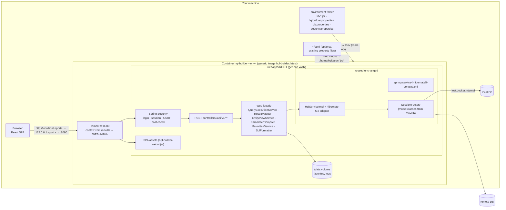

# 03: Target architecture

## 1. Requirements from the owner (2026-09-23)

- Everything runs **locally**. Images are built and used on the user's machine and **never leave it**.
- Per environment the user supplies the **model jar(s)**, the **DB properties** and the **security
  properties (username and password)**. Other inputs give another environment, and several run side by side.
- **Reuse the backend** as much as possible. **Only the frontend moves to the web** (React).
- **Only the web port** is published from the container. A login protects the backend.
- Users have **JDK 17/21, Maven and Node 24** (mostly Windows, some Ubuntu). The WAR is built on the
  host, and Docker packages and runs it.
- Preferred: Docker **reads the model jar and properties from the host** (bind mount), so a new
  model jar needs a restart, not a rebuild. A baked, self-contained image stays possible.
- Settings from the host project's Spring XML (packages to scan, SQL functions, project) move into
  the user's properties.
- The old `hql-builder-demo` is unmaintained and **out of scope**.

The packaging details are in [11-docker-packaging.md](11-docker-packaging.md).

## 2. Goals and non-goals

**Goals**

1. Feature parity with the Swing client ([02](02-feature-inventory.md)), except desktop-only features.
2. **One generic image** (Tomcat 9 plus the generic WAR). An environment is a host folder with
   `lib/` and property files, mounted into a container. A new model jar or changed properties means
   `docker restart`.
3. **Several environments side by side**, each clearly labelled (name and colour), each with its own
   capabilities (for example read-only for a production copy).
4. Reuse `HqlServiceImpl`, the Hibernate adapters and `spring-service4-hibernate5-context.xml`
   unchanged. Reuse existing property files (`hqlbuilder.config.imports`).
5. A documented JSON API (OpenAPI) between the React frontend and the Java backend.
6. The Swing client keeps working until it is retired.

**Non-goals**

- A shared or multi-user server, access from other machines, roles, SSO, a registry, CI-built
  environment images.
- A demo module or demo environment.
- Switching databases at runtime (use another environment container).
- The Jakarta / Spring 6 / Hibernate 6 upgrade (a separate track). The design must not block it.
- A mobile layout.

## 3. Big picture



- **One published port** serves the SPA and the REST API. They share an origin, so there is no
  CORS. `HqlService` is only called in-process.
- The browser must reach the API anyway, because the React code runs in the browser. A separate
  nginx frontend container would only proxy `/api`, so a single container is proposed (09, Q19).
- In **baked** mode `/env` is copied into an image built on top of the generic one. Everything else
  is identical.

## 4. Module and folder layout

```
<git root>/
├── .gitattributes                  *.sh text eol=lf (scripts copied into the image)
├── docker/                         NEW  packaging (see 11)
│   ├── Dockerfile                       generic image: tomcat:9.0-jre17-temurin + exploded WAR
│   ├── Dockerfile.env                   optional baked environment image (FROM the generic image + /env)
│   ├── entrypoint.sh                    "run" (Tomcat) | "check" (ConfigCheck against /env)
│   ├── tomcat/server.xml, setenv.sh     hardened Tomcat 9 config, JVM flags
│   ├── build-image.ps1/.sh              mvn package + docker build of the generic image
│   ├── run-env.ps1/.sh                  run an environment: /env mount, 127.0.0.1 port, data volume
│   ├── check-env.ps1/.sh                validate an environment folder without starting Tomcat
│   ├── collect-libs.ps1/.sh             fill lib/ with Maven (dependency:copy-dependencies minus what the WAR provides)
│   ├── build-env-image.ps1/.sh          optional baked image
│   ├── hash-password.ps1/.sh            {bcrypt} value for security.properties
│   └── environments/example/            commented templates (no secrets)
├── hql-builder/                    Maven root
│   ├── hql-builder-common/              + SqlFormatter, ParameterImport, favorites storage (moved from client)
│   ├── hql-builder-service/             HqlServiceImpl fixes; post-processors invoked again (SQL functions); context XML reused as-is
│   ├── hql-builder-webui/          NEW  React + TS + Vite; built with the installed Node 24; packaged as a jar with the assets
│   ├── hql-builder-webapp/         NEW  packaging war: Spring Boot 2.7 (SpringBootServletInitializer), REST API,
│   │                                    security, DTO mapping, /env config loading, ConfigCheck tool
│   ├── hql-builder-client/              Swing, unchanged except delegating to the moved classes
│   └── hql-builder-web/                 legacy, stays behind -P inc-web-modules; delete later
└── web-migration/                       these docs
```

The generic WAR is built with the normal Maven reactor on the host (the users have JDK, Maven and
Node), and it can be tested without Docker. There is no demo module (it was removed in `feb021df`).
Automated tests use a few test-scope entities on H2 (05 §10).

## 5. What is reused and what is new

| Existing piece | Reused how |
|---|---|
| `HqlServiceImpl`, `RunQuery`/`RunSqlQuery`, `QueryTranslator`, `MetadataResolver`, Lucene `InformationImpl` | as-is, plus the phase 0 fixes (05 §2) |
| `spring-service4-hibernate5-context.xml` (dataSource, sessionFactory, txManager, hqlService + `MethodLogger`) | **imported unchanged** by `webapp-context.xml`. Its `${...}` placeholders are filled from the environment folder, the imports and the built-in defaults |
| `AdditionalSqlFunctionsPostProcessor` | reused. The webapp creates it from `hqlbuilder.sql-functions.*`. `LocalSessionFactoryBeanPlus5` gets its post-processor calls back, so the functions are really registered (10 #29) |
| `LocalSessionFactoryBeanPlus5` | as-is, plus: invoke `ConfigurationPostProcessor`/`MappingsPostProcessor` again, and ignore a blank `hibernate.cfg.xml` (S11, S12) |
| the host projects' property files (e.g. `gismo.services.default.properties`, `~/conf/gismo.db.properties`) | read through `hqlbuilder.config.imports` (11 §4.5) |
| `spring-common.xml`, `commonconfig.properties`, logback includes | as-is (a console appender for `docker logs`) |
| `GroovyCompiler` | as-is (Groovy parameter mode) |
| exception types | mapped to problem+json |
| `QueryFavorite` / `QueryFavoriteUtils` (XML format) | moved to common, stored under `/data/favorites` |
| `cleanupSql/makeMultiline/removeBlanks` | moved to common as `SqlFormatter` |
| `PathResolver`, `HqlWizard.fini`, `getHqlText`, `remarkToggle`, error positions | logic ported to TypeScript |
| i18n bundles | converted to JSON |

New pieces: the REST layer and DTO mappers, security, loading the configuration from `/env`, the
React SPA, and the Docker packaging with its scripts.

## 6. How the webapp boots (no host project, no `main`)

1. `docker run` starts Tomcat. The WAR's `META-INF/context.xml` adds `/env/lib/*.jar` to the
   web-app class loader (`PostResources` mounted at `/WEB-INF/lib`).
2. `HqlBuilderWebApplication extends SpringBootServletInitializer`. An early initializer reads
   `${hqlbuilder.env.dir}` (default `/env`) and registers the property sources, from lowest to
   highest priority (11 §4.1):
   - built-in defaults;
   - `hqlbuilder.config.imports`, in order;
   - `db.properties`;
   - `hqlbuilder.properties`;
   - `security.properties`.

   OS environment variables and system properties do not override them.
3. The context loads `org/tools/hqlbuilder/webapp/webapp-context.xml`, which:
   - imports the **unchanged** service context;
   - defines `packagesToScan` from `hibernate.packagesToScan`;
   - adds the optional `hqlbuilder.extra-context` XML.

   A Java `@Configuration` creates the `AdditionalSqlFunctionsPostProcessor` from
   `hqlbuilder.sql-functions.*`.
4. `StartupValidator` re-checks the configuration and logs a banner: environment, project, the
   source of each required key (passwords masked), JDBC URL without credentials, the jars in
   `/env/lib`, the number of entities, the Hibernate adapter, the capabilities. Then the
   SessionFactory connects. If the DB is unreachable, startup fails with a readable message in
   `docker logs`. A degraded mode that still serves the UI is a phase 4 option.

## 7. Backend framework (for a WAR in Tomcat 9)

| Option | Pros | Cons |
|---|---|---|
| **A. Spring Boot 2.7.18 packaged as WAR** (`SpringBootServletInitializer`, `spring-boot-starter-tomcat` scope `provided`) | property-source handling, `@ConfigurationProperties`, auto-configured Jackson / Spring Security / error handling, springdoc for OpenAPI, actuator health; the same WAR also runs from the IDE for development | open-source support has ended (as for Spring 5.3); the Boot BOM must be ordered after the jhaws BOM so Spring stays 5.3.39 |
| B. Plain Spring MVC 5.3 WAR (`WebApplicationInitializer`, Spring Security Java config) | closest to the existing XML style; no Boot | more wiring; no springdoc (the OpenAPI spec would be written by hand) |
| C. Boot 3 / Tomcat 10+ | supported | needs Jakarta + Hibernate 6. **Blocked** |

**Recommendation: A** (Q2 in [09](09-open-questions.md)). The runtime is **Tomcat 9** (`javax.servlet`).

## 8. Frontend stack

| Concern | Choice | Alternatives considered | Reason |
|---|---|---|---|
| Language / build | TypeScript 5 + Vite, on the installed **Node 24** | CRA (dead), Next.js (SSR not needed) | fast dev server, plain static output |
| UI framework | React 19 | Vue, Svelte, Angular | the owner's choice |
| Component kit | **Mantine 7** | MUI, shadcn/ui + Radix, Ant Design | dense desktop-like components, modals, menus, notifications, hotkeys, Spotlight; MIT |
| Editor | **CodeMirror 6** | Monaco | small, custom HQL mode, completion, lint, bracket matching, comment toggle |
| Results grid | **TanStack Table v8 + TanStack Virtual** | AG Grid Community, Glide Data Grid | headless: full control over cell selection, context menu, entity cells; virtualized |
| Server state | TanStack Query | SWR, RTK Query | caching, mutations, cancellation |
| Client state | Zustand (`persist` for preferences) | Redux Toolkit, Jotai | minimal boilerplate |
| Layout | react-resizable-panels | Allotment | two layout presets |
| i18n | i18next + react-i18next | FormatJS | JSON converted from the existing `.properties` files |
| API client | openapi-typescript + openapi-fetch | orval, handwritten | types generated from springdoc |
| Tests | Vitest, React Testing Library, MSW, Playwright | Jest, Cypress | Vite-native; MSW replaces a demo backend |
| Package manager | npm (bundled with Node 24) | pnpm, yarn | simplest |

## 9. Security overview

Details are in [07](07-security.md).

- **Login** with the single user from the environment's `security.properties` (`{bcrypt}`
  recommended). JSON login endpoint; the SPA has a login page.
- The session cookie is `HttpOnly` and `SameSite=Strict`, named per environment. CSRF protection
  uses cookie-to-header tokens. The `Host` header is checked. Failed logins lead to a lockout.
- **Capabilities per environment**, enforced server-side: DML, SQL mode, Groovy, editing, schema
  script, `read-only`.
- The port is published on **127.0.0.1**. `/env` is mounted read-only. A mounted-mode image
  contains no credentials.

## 10. Request and session model

- **Stateless REST**, apart from the login session.
- **One Hibernate session per request.** Mapping to DTOs happens **inside** the session, and the
  session is then closed.
- **Query registry**: `uuid → Session`. Cancel calls `session.cancelQuery()`. The query timeout is
  configurable per environment.
- **Synchronous execution** (`POST /queries` blocks). An async variant can be added later.
- Entity identity on the wire is `{entityName, id}`, with the id as a string. Composite ids are JSON.

## 11. Swing concepts and their web equivalents

| Swing | Web |
|---|---|
| host project: `HqlBuilder.main` + `applicationContext.xml` + Maven dependencies | environment folder (`lib/` + properties), mounted into a container (11 §5 maps the GISMO example) |
| `JFrame` + `JSplitPane` layout | app shell + resizable panels |
| `HqlBuilderAction` (label, icon, shortcut, persisted value) | action registry used by menus, toolbars and the command palette |
| Java Preferences | browser `localStorage` (Zustand `persist`) |
| `~/hqlbuilder/favorites/<project>` | `/data/favorites/<project>` in the environment's volume (optionally the same host folder) |
| `SwingWorker` + glass pane | TanStack Query mutation + AbortController + progress bar |
| `JOptionPane` | Mantine modals (confirmations) and notifications (everything else) |
| l2fprod property sheet | own `PropertySheet` component |
| `ETree` object tree | tree component with lazy loading |
| System clipboard | `navigator.clipboard` (`http://localhost:<port>` is a secure context) |
| `Desktop.browse(url)` | `<a target="_blank" rel="noopener">` |
| local reflection on live entities | server-side DTOs from Hibernate metadata |

## 12. Swing during the transition

The Swing client keeps working through its host projects. Both clients can share favorites
(`-ShareSwingFavorites`) and the same `~/conf` property files (`-MountUserConf`).

## 13. Why not build on `hql-builder-web`

| Aspect | `hql-builder-web` today | Needed |
|---|---|---|
| Protocol | RESTEasy JAX-RS with JAXB/XML, plus HttpInvoker (Java serialization) | JSON |
| Security | HttpInvoker is a deserialization-RCE class (CVE-2016-1000027); removed in Spring 6 | login + CSRF, nothing else exposed |
| Deployable | no `web.xml` or webapp left | generic WAR in a Docker image |
| Dependencies | Wicket, RESTEasy 4, Spring OXM, security taglibs | minimal |
| Client | `HqlWebServiceClient` is `@Deprecated` | React/TypeScript |
