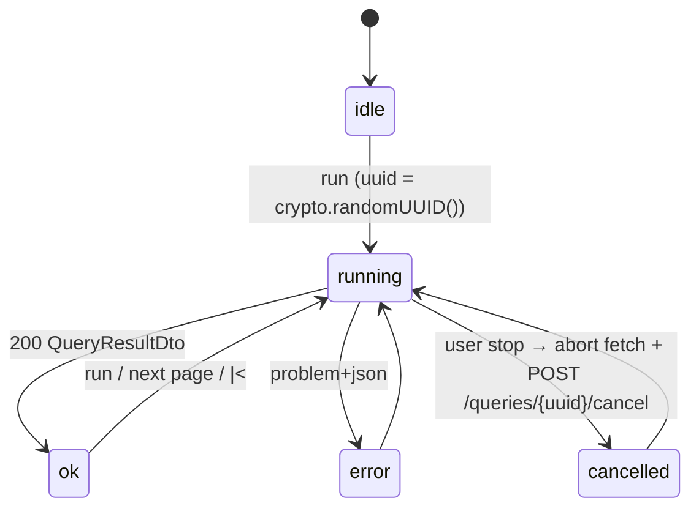
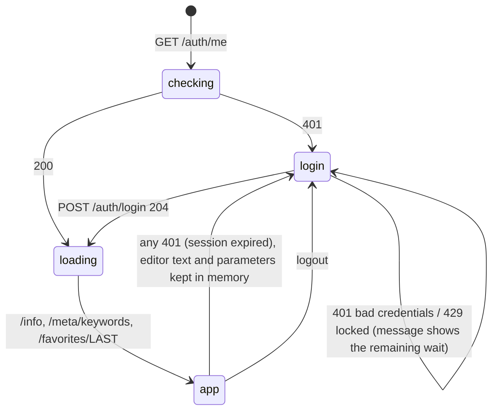

# 06: Frontend plan (React)

## 1. Principles

- **A dense, desktop-like developer tool**, not a marketing site. Small paddings, a monospace
  editor, lots of information on one screen. The minimum target is 1366×768.
- **Keyboard first.** Every action has a shortcut or appears in the command palette.
- **Parity before polish.** [02-feature-inventory.md](02-feature-inventory.md) is the scope.
  New ideas go to phase 4.
- **Typed end to end.** DTO types are generated from OpenAPI. There are no handwritten `any`s at
  the API boundary.
- **Pure logic lives in plain TypeScript modules** with unit tests (statement splitting, remark
  toggle, path finding, Java export and import). The test vectors are taken from the Java behavior.
- **Environment awareness.** Every screen shows which environment (which database) the user is
  working on: name and colour from `/info.environment` in the header and the tab title. Several
  environments are often open at once in different tabs (ports).
- **Behind a login.** The SPA is served without authentication. Every API call needs the session
  from the login page (N1 in 02).

## 2. Project layout (`hql-builder/hql-builder-webui/`)

```
hql-builder-webui/
├── pom.xml                        exec-maven-plugin runs the installed npm (Node 24) → jar with META-INF/resources/**
│                                  (-Pbundled-node: frontend-maven-plugin downloads Node 24 instead)
├── package.json                   "engines": { "node": ">=24" }; scripts: dev, build, test, gen-api
├── vite.config.ts                 dev server :5173, proxy /api → http://localhost:<port of a running environment container>
├── tsconfig.json  eslint.config.js  index.html
├── scripts/
│   ├── properties-to-json.mjs     HqlResourceBundle_*.properties → src/i18n/*.json
│   └── gen-api.mjs                openapi.json → src/api/schema.d.ts
├── src/
│   ├── main.tsx  App.tsx  theme.ts
│   ├── api/                       schema.d.ts (generated), client.ts (openapi-fetch; adds X-XSRF-TOKEN from the
│   │                              XSRF-TOKEN cookie; a 401 → session store → login page),
│   │                              queries.ts (TanStack Query hooks: useInfo, useKeywords, useGraph, ...)
│   ├── auth/                      LoginPage.tsx, sessionStore.ts, useSession (GET /auth/me at startup), logout
│   ├── actions/                   action registry: id, labelKey, icon, shortcut, when(), run()
│   ├── state/                     zustand stores: editor, parameters, results, selection, prefs (persisted)
│   ├── features/
│   │   ├── shell/                 AppShell, HeaderBar (environment badge, user menu), MenuBar, Toolbars, LayoutA/B,
│   │   │                          CommandPalette, LoadingScreen
│   │   ├── editor/                HqlEditor.tsx, hqlLanguage.ts, completion.ts, diagnostics.ts,
│   │   │                          statementAtCursor.ts, remarkToggle.ts, javaString.ts, keymap.ts
│   │   ├── sql/                   SqlPanel.tsx
│   │   ├── search/                LuceneSearchPanel.tsx
│   │   ├── parameters/            ParametersPanel.tsx, ParameterForm.tsx, ImportParameters.tsx
│   │   ├── results/               ResultsGrid.tsx, cells/*.tsx, ResultsStatusBar.tsx, Pager.tsx, ResultsContextMenu.tsx
│   │   ├── properties/            PropertySheet.tsx, editors/*.tsx
│   │   ├── objectTree/            ObjectTreeDialog.tsx
│   │   ├── favorites/             FavoritesDialog.tsx, AddFavoriteDialog.tsx
│   │   ├── wizard/                WizardDialog.tsx, pathResolver.ts, buildQuery.ts
│   │   ├── namedQueries/          NamedQueryDialog.tsx
│   │   ├── settings/              SettingsDialog.tsx
│   │   └── help/                  AboutDialog.tsx, VersionsDialog.tsx, SystemPropertiesDialog.tsx
│   ├── i18n/                      index.ts, en.json, nl.json (generated, then maintained here)
│   └── utils/                     clipboard.ts, download.ts, format.ts
├── test/                          vitest setup, MSW handlers, JSON response fixtures (recorded from the backend test fixture)
└── e2e/                           Playwright specs (MSW-mocked API by default; optionally against a running environment container)
```

## 3. Screen layout

Layout A (Swing default, "switch layout" on):

```
┌[ DEV ] HQL Builder v6.1.0 · project · user@jdbc:… ────── [⌘K] [⚙] [?] [admin ▾]┐   ← header in the environment colour
├──────────────────────────┬─────────────────────┬─────────────────────────┤
│ [HQL] [SQL] [Search]     │ Parameters          │ Properties              │
│ ▶ ■ ✦ ⌫ ⚲ ★ ☆ ≡ …        │ name  [.........] ✓ │ ▸ Read-only             │
│ 1 select p               │ value [.........] ' │   id        42          │
│ 2 from Person p          │ comp. [Long 42  ] ∅ │   name      Jane        │
│ 3 where p.id = :id       │ ┌─────────────────┐ │ ▸ Editable              │
│                          │ │ id=Long 42      │ │   status    ACTIVE ▾    │
│                          │ └─────────────────┘ │                         │
├──────────────────────────┴─────────────────────┴─────────────────────────┤
│ Results                                   ▶ 1 results in 0.01 s [max=100]│
│ #  │ Person 0            │ String 1 │                    |< [ 0 ] >      │
│ 1  │ ⬚ Person[42, Jane]  │ Jane     │                                    │
└──────────────────────────────────────────────────────────────────────────┘
```

Layout B: editor and parameters on top; results and properties at the bottom. Both layouts use
`react-resizable-panels` with `autoSaveId`, so split sizes persist per layout.

## 4. State and data flow

| Store (Zustand) | Holds | Persisted |
|---|---|---|
| `editorStore` | editor text, selection, SQL mode flag, last executed range, diagnostics | text is persisted through the `LAST` favorite on the server |
| `parametersStore` | the parameter list, selected index, form fields | with `LAST` |
| `resultsStore` | current `QueryResultDto`, paging (`first`, `max`), status (`idle`/`running`/`ok`/`error`/`cancelled`), last problem | no |
| `selectionStore` | the selected cell `(row, col)`, the selected entity `{entity, id}` | no |
| `prefsStore` | all settings from 02 §I | `localStorage` key `hqlbuilder.prefs.v1` (versioned `migrate`) |

Server data (info, keywords, classes, graph, named queries, entity views, favorites) lives in the
TanStack Query cache. Metadata uses `staleTime: Infinity`.

**Query lifecycle**



Before each run, `PUT /favorites/LAST` is sent (fire and forget, like `preQuery` in Swing). At
startup the app calls `GET /favorites/LAST` and restores the editor text and parameters.

**Startup and session**



- The login page shows the environment name and colour, taken from the `environment` field of the
  401 answer of `GET /auth/me` (04 §1). The user can tell which database they are about to log in to.
- The password is never stored (not in `localStorage`, not in state after the request). The session
  lives only in the HttpOnly cookie.
- After a 401 in the middle of work, the unsaved editor state stays in memory. After logging in
  again, the user continues, and a running query is not retried automatically.

## 5. HQL editor (CodeMirror 6)

Extensions: `lineNumbers`, `history`, `drawSelection`, `highlightActiveLine`, `bracketMatching`,
`closeBrackets` (pref), `autocompletion`, `lintGutter`, `search` with `highlightSelectionMatches`,
the custom `hqlLanguage`, `keymap`, and the theme from prefs (font family/size, keyword colour,
brace colour, search colour).

**Language (`hqlLanguage.ts`)**: a `StreamLanguage` tokenizer:

- keywords from `GET /meta/keywords`, case-insensitive, with the same separator rules as `isSeperator`
  in Swing;
- strings `'...'` (`''` escapes);
- numbers with an optional `l`/`L` suffix;
- `:name` parameters and `?` positional parameters;
- line comments `--` and `//`;
- `languageData: { commentTokens: { line: "--" } }`.

**Statement under the cursor (`statementAtCursor.ts`)**, ported from `getHqlText` (line 1842):

```ts
export function statementAtCursor(doc: string, from: number, to: number): { text: string; start: number; end: number } {
  let begin = Math.min(from, to), end = Math.max(from, to);
  if (begin === end) {
    // Java: substring(0, begin).lastIndexOf(";") + 1. The guard matters because JS lastIndexOf(";", -1) still checks index 0.
    begin = begin === 0 ? 0 : doc.lastIndexOf(";", begin - 1) + 1;
    end = doc.indexOf(";", end); if (end === -1) end = doc.length;
  }
  const raw = doc.substring(begin, end).replaceAll(";", " ");
  // blank out comments per line, keeping positions ('--' as in Swing; '//' as an improvement, B3)
  const text = raw.split(/\r?\n/).map(blankComment).join("\n");
  return { text, start: begin, end };
}
```

Edge cases to cover with tests:

- a caret right after `;`;
- no `;` in the document;
- a selection that spans a `;`;
- `--` inside a string literal (Swing does not handle it; decide whether to match or fix, and
  document the choice).

**Retry rule** (B5): when running a non-empty selection fails, collapse the selection and run the
whole statement once.

**Diagnostics (`diagnostics.ts`)**, ported from `hilightSyntaxException` (line 2217). Map
`{syntaxType, wrong, line, col}` to document ranges:

- `unexpected_token`: `line`/`col` are relative to the **executed statement**, so add the
  statement's start offset (Swing counts lines up to the selection start).
- `invalid_path`, `not_mapped`, `unable_to_resolve_path`: every occurrence of `wrong`.
- `could_not_resolve_property`: `"." + wrong.split("#")[1]`, only when followed by a non-letter.
- `illegal_attempt_to_dereference_collection`: the last path segment, with `#` replaced by `.`.

Place the caret at the first range. The tooltip text is the problem `detail`, cut before the first
`[` (as in Swing).

**Completion (`completion.ts`)**, the successor of `helpInsert`:

| Context before the cursor | Source |
|---|---|
| `from ` / `join ` / `, ` inside a FROM clause | classes from `/meta/classes`: label `SimpleName`, detail = package, apply = simple name |
| `ident.` or `ident.a.b.` | resolve `ident` through `fromAliases` from `/hql/analyze` (debounced, cached per text hash), with a local regex fallback over `from|join <Entity> [as] <alias>`; then `/meta/property-names?entity=&path=`; hide names that start with `_` (as in Swing) |
| `:` | known parameter names |
| elsewhere | keywords |

Trigger it explicitly with Ctrl+Space and Ctrl+Shift+Space (the Swing key), and implicitly after `.`.

**Other editor commands**

- Remark toggle: port `remarkToggle` (line 2596) exactly (whole-line expansion, removal of both
  `--` and `//`). Bind Ctrl+Shift+/ and Ctrl+/.
- Format: `POST /hql/format`. Replace the document in one transaction so it can be undone.
- Delete inverted selection (B16).
- Java export and import (`javaString.ts`, ported from lines 1611 and 2317). Export produces
  `String hql = "";` followed by one `hql +=" <line>";` per line; comment lines become `// ...`.
- Hover (`hoverTooltip`): on `:name` show the parameter's display value; on `?` count the previous
  `?`s outside comments (as in Swing, lines 813-833).
- Executed-range decoration while running and after running, when "select HQL being executed" is on.

## 6. Results grid

- TanStack Table in manual mode (no client-side sorting by default, because the server order
  matters; client-side sorting of the current page is an optional toggle). Rows are virtualized with
  TanStack Virtual; columns can be virtualized too when there are more than 50.
- Columns: a sticky row-number column, then `ColumnDto` in order. Headers show the `label`
  (`<SimpleType> <alias>`); the tooltip shows the FQN.
- Cell renderers per `CellDto.t`:
  - `null`: dimmed italic `null`;
  - `entity`: icon plus text, styled like a link; clicking selects the cell and loads the property
    panel;
  - `decimal`: right-aligned;
  - `temporal`: ISO text;
  - `binary`: `‹n bytes›`;
  - `object` and `collection`: text.
- **Selection model**: a single active cell `(row, col)` with arrow-key navigation, Enter to open
  the object tree, and Ctrl+C to copy the cell text.
- **Context menu** (`ResultsContextMenu.tsx`):
  - Show properties;
  - Object tree;
  - Copy cell;
  - Copy row;
  - Copy table as TSV;
  - Copy property names (the Swing "hibernate properties");
  - Delete object (when editable);
  - Column script (phase 4, see 09 Q9).
- **Column sizing**: measure the text of the header and the first N rows with a canvas and
  auto-size, limited to 600 px. The "resize columns" pref switches to fit-to-width.
- **Status bar**: `N results in X s`, `No results`, or `N rows affected`. The `[max=N]` badge is red
  when N > 500 or N ≤ 0, and clicking it edits the value. Pager: `|<`, `<` (new), the start index
  input, `>`, disabled based on `hasMore`.
- **CSV download**: the button posts the current request to `/queries/export.csv`. It uses
  `fetch` + `Blob` + an `<a download>` link, so the CSRF header can be sent.

## 7. Properties panel

- `PropertySheet` renders an `EntityViewDto`. It groups properties into collapsible sections
  (Read-only, Editable, No editor), sorted by name, as the Swing `PropertyPanel` does.
- Value rendering reuses the grid cell renderers. Entity references can be clicked (they navigate
  the panel; the back button returns to the previous entity). Collections show a "Load..." button,
  or "Open in object tree".
- Editing (phase 3): inline editor per kind:
  - text input for strings;
  - numeric input for numbers and decimals, keeping the string value for precision;
  - checkbox for booleans;
  - date or date-time picker for temporals;
  - select for enums, with an empty option meaning null (as in the Swing `EnumEditor`).

  Commit on Enter or blur by sending `PATCH` with `{version, changes: {prop: value}}`. On success,
  show a toast "old → new" and replace the view with the response. On a 422, show messages per
  property. On a 409, show a conflict notice with a reload action.
- Drag and drop: each property row is `draggable` with `text/plain` = the property name, and the
  editor accepts the drop (B24).

## 8. Object tree dialog

A modal dialog with a split view: a tree on the left and a `PropertySheet` on the right.

- The root is the selected entity.
- Children of an entity node are its to-one and collection properties (from `EntityViewDto`).
- Children of a collection node come from `/entities/{e}/{id}/collections/{prop}` pages
  ("load more" per 50).
- Node label: `SimpleName name = text`, as in `ObjectTree.TreeNode`.
- Nodes load lazily when expanded, and the loaded state is cached per dialog.

## 9. Wizard

This ports `HqlWizard` and `PathResolver` onto `GraphDto`.

`pathResolver.ts` is a generator. It yields paths in the same breadth-first order as the Java code,
so "continue search" gives the same next path:

```ts
export function* findPaths(graph: GraphIndex, source: string, target: string): Generator<PathStep[]> { /* BFS with exclude list */ }
```

The Java version excludes nodes already visited through the same `(node, property)` pair. Replicate
that exactly, and write tests that compare the first N paths with the Java implementation on the test-fixture
model (generate fixtures from a small JUnit test).

UI steps:

1. Choose the source class (a searchable list).
2. Choose the target class, or "none", which adds only the source.
3. For each found path, show it and offer Accept, Continue search, or Stop.
4. Accepted paths become rows: collection flag, class, parent, path, inner join (checkbox), select
   (checkbox).
5. Double-click a row to search from that row to a new target (Swing: `selectTargetAfterSource(row)`).
6. Done calls `buildQuery.ts` (a port of `fini()`), which writes
   `select <aliases> from <root> <alias> [inner|left outer] join <parent>.<path> <alias> ...` into
   the editor. Aliases are made unique through `aliasUses`, and `SUB(...)` rows are skipped (a TODO
   in Swing too).

## 10. Parameters panel

- List rows show `index:` or `name=`, the type, and the display value (like `QueryParameter.toString()`).
- Form fields:
  - **Name**;
  - **Value**: the Groovy text, or typed text with a type selector in typed mode;
  - **Compiled**: read-only, filled by `/parameters/compile` 300 ms after typing stops. It shows the
    error text when compilation fails.
- Buttons: Save (also Enter in Name or Value), To text (`'…'`), Set null, Add, Up, Remove (removes
  the selection, or everything when nothing is selected, as in Swing), Down, Find parameters (Alt+F3).
- In Groovy mode only, apply the Swing heuristics while typing: ISO date → `new LocalDate(y,m,d)`,
  and pure digits → append `l`. When the expected type is known from `findParameters`, prefer typed
  conversion instead.
- An import field accepts JSON, a Groovy map or a list, and calls `/parameters/import`. Named
  parameters are merged by name, positional ones are appended.

## 11. Favorites, named queries, search, help

- **Favorites dialog**: a table (name, parameters preview, HQL preview), a filter input, restore by
  double-click or Enter, delete with confirmation, cancel. **Add favorite**: a name input with
  validation; it warns when the last run did not succeed (as in Swing).
- **Named queries**: a filterable list. OK replaces the editor text after `clear()`.
- **Lucene search tab**: an input with class and field checkboxes. The result list is clickable and
  inserts the text at the editor cursor (D4). The tab is hidden when the capability is missing.
- **Help menu**:
  - documentation links from `/info.helpUrls`;
  - the wiki;
  - Versions (`/info.hibernate`);
  - About (logo, version, latest version, download link);
  - System properties (when the capability is on).

## 12. Settings

A dialog with sections that map 1:1 to 02 §I:

- Query: max results, max search results, editable results.
- SQL formatting: format SQL, remove joins, format lines, replace properties.
- Editor: font family and size, highlight syntax and its colour, highlight braces and its colour,
  auto-close brackets, error tooltip, select executed HQL, search colour.
- Layout: preset A/B, show toolbars, resize columns.
- Language, theme (system/light/dark).
- Reset to defaults.

Settings are stored in `prefsStore`, persisted in `localStorage`, and apply immediately (no restart).
Server limits in `/info.limits` clamp the values.

## 13. Internationalization

- `scripts/properties-to-json.mjs` converts `HqlResourceBundle_en.properties` and `_nl` into
  `en.json` and `nl.json`. It decodes ISO-8859-1 and `\uXXXX`, keeps the keys (including the
  `.short`/`.long` variants), and turns `{0}` into `{{0}}`. Run it once, then maintain the JSON
  in the webui module. The Swing bundles stay as they are.
- `DidYouKnow` tips appear on the loading screen. They are Dutch only today, so add English versions.
- The language is detected from the browser, can be overridden in settings, and switches live.

## 14. Keyboard shortcuts

Browser and OS constraints drive this mapping:

- **Alt+F4** closes the window on Windows.
- **Ctrl+Shift+Delete** opens "clear browsing data" and cannot be overridden.
- **Ctrl+Delete** is "delete word forward" in the editor.
- **AltGr = Ctrl+Alt** on Belgian AZERTY and many other European layouts. AltGr+2/3/9/0/^/$
  type `@ # { } [ ]`, so **never bind Ctrl+Alt+<key>** in the editor.
- F1 can be intercepted in Chrome (`preventDefault`).

| Action | Swing | Web (proposal) | Note |
|---|---|---|---|
| Start query | Ctrl+Enter | Ctrl+Enter | also Cmd+Enter on macOS |
| Stop query | click the progress bar | Esc (while running, no dialog open) or the Stop button | new shortcut |
| Help | F1 | F1 | preventDefault |
| Wizard | Alt+F1 | Alt+F1 | |
| Clear | Alt+F2 | Alt+F2 | confirm when the editor is not empty (optional) |
| Find parameters | Alt+F3 | Alt+F3 | |
| Favorites | Alt+F4 | **Alt+F6** | Alt+F4 closes the window |
| Add to favorites | Alt+F5 | Alt+F5 | |
| Format | Alt+F9 | Alt+F9 (plus Shift+Alt+F) | |
| Named query | Alt+F10 | Alt+F10 | |
| Export as Java | Alt+F11 | Alt+F11 | |
| Import from Java | Alt+F12 | Alt+F12 | |
| Autocomplete | Ctrl+Shift+Space / Ctrl+Shift++ | Ctrl+Space, Ctrl+Shift+Space | |
| Remark toggle | Ctrl+Shift+/ | Ctrl+Shift+/ and Ctrl+/ | |
| Delete inverted selection | Ctrl+Delete | **Alt+Delete** plus the command palette | Ctrl+Delete is taken by the editor |
| Hibernate properties | Shift+Alt+F8 | Shift+Alt+F8 | |
| Object tree | Shift+Alt+F9 | Shift+Alt+F9, Enter on an entity cell | |
| Delete object | Shift+Alt+F10 | Shift+Alt+F10, Delete key on a cell (with confirmation) | |
| Copy cell | Shift+Alt+F11 | Shift+Alt+F11, Ctrl+C in the grid | |
| Column script | Shift+Alt+F12 | Shift+Alt+F12 | phase 4 |
| Command palette | – | Ctrl+K and Ctrl+Shift+P | new; Mantine Spotlight |

Shortcuts live in the action registry, so a later version can make them configurable.

## 15. Theming and accessibility

- Mantine theme with CSS variables. Light, dark and system. Editor colours come from prefs, with
  defaults equal to the Swing colours (keyword `#138013`, brace `#A4A4E2`, search `#F5E191`).
- Dialogs trap focus, and every icon button has an `aria-label` and a tooltip with its shortcut.
- The grid exposes `role="grid"` semantics with `aria-rowindex` and `aria-colindex`.
- Swing shows many modal `JOptionPane` popups. Use non-blocking toasts for success and info messages,
  and keep modals for confirmations only.

## 16. Tests

| Level | Scope | Tooling |
|---|---|---|
| Unit | `statementAtCursor`, `remarkToggle`, `javaString` export and import, diagnostics mapping, `pathResolver` (fixtures from Java), `buildQuery`, parameter heuristics, cell formatting | Vitest |
| Component | editor commands, grid selection and context menu, parameter form, property sheet editing, favorites dialog | Vitest + React Testing Library + MSW |
| End to end | UI flows against an **MSW-mocked API** (there is no demo backend, D10): login and logout, the lockout message, session expiry back to login, environment badge, run, page, cancel, error highlight, autocomplete, favorites round trip, edit and delete an entity, wizard, CSV download, read-only environment hides editing | Playwright (Chromium, Firefox, WebKit) + MSW |
| End to end (optional) | the same specs against a real environment container (a developer's own environment folder, or the CI throwaway fixture environment, 05 §10): proves the real API contract, CSRF rejection and cookies | Playwright |

## 17. Performance

- Metadata is fetched once. `/hql/analyze` is debounced and cached by text hash.
- The grid is virtualized, and the server caps the row count.
- Code splitting: the wizard, object tree, settings and help dialogs load lazily. The initial
  bundle target is under 500 kB gzip including CodeMirror.
- Only the changed store slices re-render (Zustand selectors), so typing never re-renders the grid.
