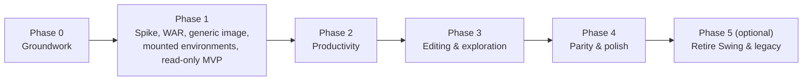

# 08: Roadmap

The work is split into phases. Each phase ends in a usable state, and the Swing client keeps
working throughout. Task IDs (`P1-07`) can be referenced in commits and issues. Feature IDs
(`B13`) refer to [02-feature-inventory.md](02-feature-inventory.md).

Sizes are rough T-shirt estimates for one developer familiar with the codebase: **S** ≤ 1 day,
**M** 2-4 days, **L** 1-2 weeks. They exist to compare tasks, not to promise dates.

## Phase 0: groundwork (no UI)

**Goal:** make the existing modules ready for a web backend, without changing Swing behavior
(apart from bug fixes).

- [ ] P0-01 (S) Settle the blocking decisions in [09](09-open-questions.md): Q2, Q3, Q19, Q25, Q26.
- [ ] P0-02 (M) Test-scope fixture in `hql-builder-service/src/test` (about 10 entities, H2,
      `import.sql`, one custom SQL function), published as a test-jar (05 §10). Not a demo, never shipped.
- [ ] P0-03 (M) Characterization tests: `cleanupSql` outputs, exception regex mapping (fixture),
      favorites XML v1/v2/v3 reading.
- [ ] P0-04 (M) Move `SqlFormatter`, `QueryFavorite(Utils)` (configurable base directory) and
      `ParameterImport` into `common` (05 §2.1). Swing delegates.
- [ ] P0-05 (M) `HqlServiceImpl`: concurrent maps, session registry, real cancel, the
      `execute(qp, ResultHandler)` overload (S1-S4).
- [ ] P0-06 (S) DML detection in all `RunQuery` copies (S6); `sql()`, `save()`/`delete()` fixes
      (S7, S8); Groovy logging (S9); blank `hibernate.cfg.xml` (S11).
- [ ] P0-07 (S) **Invoke the configuration post-processors again** in `LocalSessionFactoryBeanPlus5`
      (S12) and fix the default type in `AdditionalSqlFunctionsPostProcessor` (S13). Add a regression
      test with the fixture. Check the GISMO Swing setup, which gets its 19 SQL functions registered
      for the first time.
- [ ] P0-08 (M) `EntityIntrospector` interface in common, with the 5.x implementation (05 §2.3).
- [ ] P0-09 (S) Fix the favorites delete path and validate names (10, issues #4 and #5).

**Exit criteria:** `mvn verify` passes on Windows and Ubuntu; a manual Swing smoke test with the GISMO
host project behaves as before (plus working SQL functions); the new tests run in CI.

## Phase 1: spike, WAR, generic image, mounted environments, read-only MVP

**Goal:** a user with JDK, Maven, Node 24 and Docker:

1. builds the generic image once;
2. points it at an environment folder (model jars + properties, or imports of existing `~/conf` files);
3. logs in;
4. does the everyday read-only loop.

A **new model jar needs only `docker restart`**.

Spike first:

- [ ] P1-01 (M) **Spike** on Windows (Docker Desktop) and Ubuntu:
  - Tomcat 9 `PostResources` `/env/lib` → `/WEB-INF/lib` class loading (entities found, annotations visible);
  - Spring SCI discovery with the JarScanFilter;
  - a read-only bind mount;
  - `--user <uid>:0`;
  - `host.docker.internal` to a host DB;
  - jar replacement followed by `docker restart`.

  Record the outcome in 09. Fallback if `PostResources` fails: an entrypoint that copies
  `/env/lib/*.jar` into `webapps/ROOT/WEB-INF/lib` at container start. That gives the same user
  experience at the cost of a copy.

Backend:

- [ ] P1-02 (M) Module `hql-builder-webapp` (packaging `war`): Boot 2.7 `SpringBootServletInitializer`,
      Tomcat `provided`, BOM order, excluded auto-configuration, `webapp-context.xml`, `META-INF/context.xml`,
      `provided-artifacts.txt`.
- [ ] P1-03 (M) Environment configuration (05 §3.5): `EnvironmentPropertySources` (files, imports,
      priorities, masking, origins), `SqlFunctionsConfig` (raw keys), `ExtraContextInitializer`,
      `StartupValidator` with the banner.
- [ ] P1-04 (M) `ConfigCheck` (05 §3.8) with good and broken fixture folders.
- [ ] P1-05 (M) Security (07 P1 items 1-10, 13, 14): login, per-environment cookie, CSRF, host
      allow-list, throttling, headers, `CapabilityService` with read-only, security tests.
- [ ] P1-06 (S) `GET /health`, `/auth/me`, `/info`, `/system/environment`, `/meta/keywords`, `/meta/classes`, `/meta/graph`.
- [ ] P1-07 (L) `POST /queries` with `ResultMapper`/`CellMapper`, cancel, problem+json advice, `formattedSql`.
- [ ] P1-08 (S) `POST /hql/parameters`, `/hql/format`, `/parameters/compile` (Groovy mode).
- [ ] P1-09 (M) `GET /entities/{e}/{id}` (read-only view).
- [ ] P1-10 (S) `GET/PUT /favorites/LAST` under `/data/favorites`.
- [ ] P1-11 (S) springdoc OpenAPI, plus the TypeScript type generation script.

Packaging ([11](11-docker-packaging.md)):

- [ ] P1-12 (M) Generic image: `docker/Dockerfile`, `entrypoint.sh` (run/check), `tomcat/server.xml`,
      `setenv.sh`, `.gitattributes` (LF for `*.sh`).
- [ ] P1-13 (M) Scripts in `.ps1` and `.sh`: `build-image` (mvn + docker build, `-SkipMaven`,
      `-JavaVersion`, `-HibernateVersion`, `--pull`); `run-env` (read-only `/env` mount, 127.0.0.1
      port, volume, `-MountUserConf`, `-ShareSwingFavorites`, `host-gateway`, uid on Ubuntu, runs
      `check` first); `check-env`; `hash-password`.
- [ ] P1-14 (M) `collect-libs` (`dependency:copy-dependencies` minus `provided-artifacts.txt`), from a
      host project pom or an environment pom.
- [ ] P1-15 (S) `docker/environments/example/` templates, plus a GISMO-style example in the docs (11 §5).
- [ ] P1-16 (S) CI: build the generic image; throwaway fixture environment; container smoke test.

Frontend:

- [ ] P1-17 (M) Module `hql-builder-webui`: Vite + React + TS + Mantine, built with the installed Node 24
      (`exec-maven-plugin`, `-Pbundled-node` fallback), jar packaging, dev proxy to an environment
      container, ESLint/Prettier, Vitest, MSW.
- [ ] P1-18 (M) Login page (environment name and colour), 401 handling that keeps the editor state,
      logout, loading screen, header with the environment badge, error boundary.
- [ ] P1-19 (M) App shell with layouts A/B (A1, A2, A6), action registry, menu bar skeleton.
- [ ] P1-20 (L) HQL editor (B1-B11, B14, B15, B19).
- [ ] P1-21 (S) SQL tab (C1-C4).
- [ ] P1-22 (M) Parameters panel in Groovy mode (E1-E7, E9).
- [ ] P1-23 (L) Results grid (F1-F8, F15).
- [ ] P1-24 (M) Read-only property panel with entity navigation (G1, G2).
- [ ] P1-25 (S) LAST autosave and restore (H3).
- [ ] P1-26 (M) Query lifecycle: progress, stop, cancel (A8, B6).

**Exit criteria:**

- On Windows and Ubuntu: `build-image` → `collect-libs` → `run-env` works for **the GISMO
  environment** (imports of the existing `~/conf` property files, 19 SQL functions) and for at
  least one other environment, side by side.
- Replacing the model jar plus `docker restart` picks up the new classes **without any image rebuild**
  (visible in the startup banner).
- `check-env` gives actionable messages for a missing driver, a missing dependency, a bad
  package or a missing import.
- The everyday loop works in Chromium, Firefox and Edge. The security tests and the container smoke
  test pass.

## Phase 2: productivity

**Goal:** daily users can switch from Swing for all read-only work.

- [ ] P2-01 (M) `/hql/analyze` plus autocompletion (B13), parameter hover (B12).
- [ ] P2-02 (M) Favorites dialog (H1, H2, H4); `-ShareSwingFavorites` verified with Swing running in parallel.
- [ ] P2-03 (S) Named queries (B20).
- [ ] P2-04 (L) Wizard: `GraphDto`, TypeScript `pathResolver` with fixtures generated from Java, UI, `buildQuery` (B21).
- [ ] P2-05 (S) Lucene search tab (D1-D4).
- [ ] P2-06 (S) SQL mode toggle (B22).
- [ ] P2-07 (S) Import parameters (E8) and the typed parameter mode (E10).
- [ ] P2-08 (S) Java string export and import, delete inverted selection (B16-B18).
- [ ] P2-09 (M) Settings dialog, language switch, i18n (en/nl).
- [ ] P2-10 (M) CSV streaming export, copy as TSV, property names copy (F9, F13, F14).
- [ ] P2-11 (S) Help menu, About/Versions with environment details (J1, J2, J4, J5, N4, N5).
- [ ] P2-12 (S) Context menus (A7).
- [ ] P2-13 (S) Optional baked mode: `Dockerfile.env` + `build-env-image` (11 §8).

**Exit criteria:** every Keep and Adapt item for sections B-F, H (except H5/H6) and J is ticked.

## Phase 3: editing and exploration

- [ ] P3-01 (M) `EntityEditService` plus `PATCH` / `DELETE` (conversion, validation, optimistic locking).
- [ ] P3-02 (M) Editable property sheet (G3, G4).
- [ ] P3-03 (S) Delete object from the grid (F11).
- [ ] P3-04 (M) Collection pages and the object tree dialog (F10).
- [ ] P3-05 (S) Drag a property name into the editor (B24, G5).
- [ ] P3-06 (S) Audit log and the DML confirmation.

**Exit criteria:** editing tests pass; every edit and DML statement is audited.

## Phase 4: parity and polish

- [ ] P4-01 (M) Column scripts, per decision Q9 (F12).
- [ ] P4-02 (S) System properties dialog, schema DDL viewer (J3, K2).
- [ ] P4-03 (M) Command palette, keyboard shortcut review (A5, 06 §14).
- [ ] P4-04 (S) Dark theme, accessibility pass.
- [ ] P4-05 (M) Playwright suite (MSW-mocked plus an optional run against a fixture environment container).
- [ ] P4-06 (M) User documentation (from 11): set up an environment, reuse existing property files,
      collect libs, run, update, troubleshoot. It replaces `readme.apt`/`info.apt`.
- [ ] P4-07 (M, optional) Degraded startup mode when the DB is unreachable (05 §3.7).
- [ ] P4-08 (S, optional) Export a self-contained environment WAR for a plain Tomcat 9 (11 §8);
      `compose.example.yaml`.
- [ ] P4-09 (S, optional) Query history (H5), multiple editor tabs (H6).

**Exit criteria:** the feature inventory is 100% ticked except for dropped items; the user docs are published.

## Phase 5: transition (optional, later)

- [ ] P5-01 Announce the Swing deprecation; keep releasing it for N versions (Q10).
- [ ] P5-02 Remove `hql-builder-web` (legacy RESTEasy/HttpInvoker), fix or remove `hql-builder-full`,
      and remove the leftover `deploy.skip.demo` property.
- [ ] P5-03 Remove `hql-builder-client` (Swing), `jhaws-swing`, l2fprod/MigLayout/AspectJ.
- [ ] P5-04 Jakarta / Spring 6 / Boot 3 / Hibernate 6 track. Tomcat 10.1+ base image; model jars
      move to `jakarta.persistence`.

## Milestones

| Milestone | Contents | What can be shown |
|---|---|---|
| M0 | Phase 0 done | Swing with the GISMO config behaves as before, with SQL functions now registered |
| M1 | spike (P1-01) plus the first skeleton (P1-02/03/05/07, P1-12/13, P1-17/18, basic editor and grid) | `build-image`, `run-env` for GISMO, log in, run one query |
| M2 | Phase 1 done | two environments side by side; model jar swap plus restart; daily read-only loop |
| M3 | Phase 2 done | switch from Swing for read-only work |
| M4 | Phase 3 done | editing parity |
| M5 | Phase 4 done | full parity, user docs |

## Risks

| Risk | Likelihood | Impact | Mitigation |
|---|---|---|---|
| Tomcat `PostResources` class loading from `/env/lib` behaves differently than expected | medium | high | spike first (P1-01); fallback: copy the jars into `WEB-INF/lib` at container start |
| Result serialization edge cases (proxies, lazy `toString()`, composite ids) | high | medium | mapping inside the session, guarded `toString()`, fixture edge cases |
| Model jars need extra runtime dependencies, another Hibernate line, or `jakarta.persistence` | high | medium | `collect-libs`; `check-env` hints; `-HibernateVersion` |
| Enabling the post-processors (S12) changes behavior in Swing setups that relied on missing functions | low | medium | intended fix; regression test; verify the GISMO queries |
| Imported property files contain container-unfriendly values (`localhost` URLs, `hbm2ddl=update`) | medium | medium | overrides in `db.properties` / `hqlbuilder.properties`; the startup check refuses unsafe hbm2ddl; troubleshooting |
| Java 21 runtime + Hibernate 5.6's ByteBuddy version | medium | medium | JRE 17 by default; test JRE 21; `-Dnet.bytebuddy.experimental=true` or a newer ByteBuddy |
| Windows CRLF breaks shell scripts in the image | medium | medium | `.gitattributes` (`*.sh eol=lf`); a smoke test in CI |
| Ubuntu file permissions on bind mounts | medium | low | `--user $(id -u):0` in `run-env.sh`; the image is group-0 writable |
| A DB on the host is unreachable from the container | medium | medium | `host.docker.internal` + `host-gateway`; troubleshooting |
| Docker Desktop licensing or availability in the organisation | medium | medium | check the Docker Desktop terms; alternatives are Docker Engine in WSL2 or Rancher Desktop |
| Fixing session leaks changes the Swing lazy-loading UX | medium | medium | opt-in; Swing keeps the old behavior (S4) |
| Boot 2.7 / Spring 5.3 / Tomcat 9 support windows | certain | medium | a framework-light web layer; regular image rebuilds; phase 5 |
| Scope creep | medium | medium | parity first |
