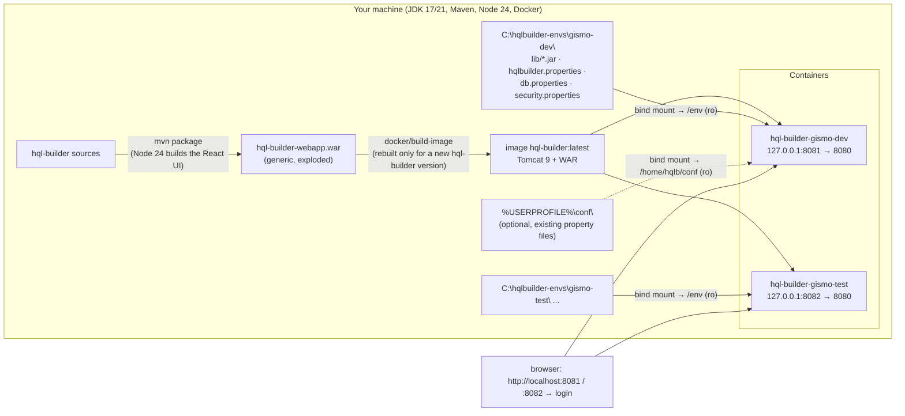

# 11: Docker packaging and environments

How a user turns **model jar(s) and property files** into a running HQL Builder for a given
database ("environment"), and how several environments run side by side.

## 1. Requirements and clarifications (owner, 2026-09-23)

1. Everything runs **locally**, never on a server. **Images never leave the user's machine.** The user
   builds them, rebuilds them when needed, and starts containers from them. There is no registry.
2. Per environment the user provides the **model jar(s)**, the **database connection
   properties** and the **security properties** (UI username and password).
3. Another set of inputs gives another environment. Several environments can run at the same time.
4. The backend reuses the existing Java code. Only the frontend moves to the web (React).
5. Only the web port is published. A login protects the backend.
6. Users already have **JDK 17/21, Maven and Node 24** installed. Most use Windows, a few Ubuntu.
   So the WAR is built on the host with Maven, and Docker packages and runs it.
7. **Extra possibility (the recommended default):** Docker reads the model jar and the properties
   **from the host at startup**, instead of baking them into the image. A changed model jar (which
   happens often) then needs only a container restart, never an image rebuild.
8. Settings that the host project's Spring XML used to hold (packages to scan, extra SQL functions,
   project name) move into the user's properties.

## 2. Two ways to supply an environment

Both modes use the **same generic image** (Tomcat 9 plus the generic `hql-builder-webapp` WAR) and
the **same environment folder layout** (§4). The webapp always reads its environment from `/env`
inside the container. It does not care whether `/env` is a bind mount or part of the image.

| | **Mounted (recommended default)** | Baked (optional) |
|---|---|---|
| What is in the image | Tomcat + generic WAR only. The image is identical for all environments | generic image + a copy of the environment folder in `/env` |
| Where the model jar and properties live | on the host, bind-mounted read-only at `/env` | inside the image |
| New model jar / changed properties | replace the file → `docker restart <container>` (seconds, plus the SessionFactory start) | rebuild the environment image (seconds) → re-create the container |
| New hql-builder version | rebuild the generic image once → re-create the containers | rebuild the generic image and every environment image |
| Credentials in the image | **none** | yes (they stay on the machine, requirement 1) |
| Can reuse existing files such as `~/conf/gismo.db.properties` | yes (mount `~/conf`) | only by copying them into the environment folder |
| Good for | day-to-day work with frequently changing models | a frozen, self-contained snapshot of an environment |



## 3. Building the generic image

### 3.1 Prerequisites (already present on the users' machines)

- JDK 17 or 21 and Maven 3.9+.
- **Node 24** on the `PATH`. The frontend build uses the installed Node (06 §2, 05 §12).
- Docker Desktop (Windows, macOS) or Docker Engine on Ubuntu. BuildKit is the default builder.
- Access to Maven Central and `github.com/jurgendl/mvn-repo` (the jhaws artifacts), or the local
  `~/.m2` that already contains them.

### 3.2 Command

```powershell
.\docker\build-image.ps1                     # mvn -pl hql-builder-webapp -am package, then docker build → hql-builder:<version> + :latest
.\docker\build-image.ps1 -SkipMaven          # reuse the WAR that is already built
.\docker\build-image.ps1 -JavaVersion 21     # runtime JRE 21 instead of 17 (see §10, ByteBuddy note)
.\docker\build-image.ps1 -HibernateVersion 5.4
```

```bash
./docker/build-image.sh [--skip-maven] [--java-version 17|21] [--hibernate-version 5.4|5.5|5.6]
```

Rebuild the generic image only for a **new hql-builder version** or to pick up **base image
patches** (Tomcat 9, JRE). The script uses `--pull`.

### 3.3 `docker/Dockerfile` (generic image, sketch)

```dockerfile
# syntax=docker/dockerfile:1.7
ARG JAVA_VERSION=17
FROM tomcat:9.0-jre${JAVA_VERSION}-temurin
ARG HQLB_VERSION
RUN rm -rf /usr/local/tomcat/webapps/* \
 && mkdir -p /env/lib /data /home/hqlb \
 && useradd --system --uid 10001 --gid 0 --home-dir /home/hqlb hqlb \
 && chgrp -R 0 /usr/local/tomcat /data /home/hqlb && chmod -R g=u /usr/local/tomcat /data /home/hqlb
COPY docker/tomcat/server.xml /usr/local/tomcat/conf/server.xml
COPY docker/tomcat/setenv.sh  /usr/local/tomcat/bin/setenv.sh
COPY docker/entrypoint.sh     /usr/local/bin/hqlb-entrypoint
# the exploded WAR directory that maven-war-plugin writes (target/hql-builder-webapp/)
COPY --chown=10001:0 hql-builder/hql-builder-webapp/target/hql-builder-webapp/ /usr/local/tomcat/webapps/ROOT/
LABEL org.opencontainers.image.title="hql-builder" org.opencontainers.image.version="${HQLB_VERSION}"
USER 10001
VOLUME /data
EXPOSE 8080
ENTRYPOINT ["hqlb-entrypoint"]
CMD ["run"]
```

`docker/entrypoint.sh` supports two commands. `run` (the default) runs `catalina.sh run`. `check`
runs `ConfigCheck` against `/env` without starting Tomcat and without touching the database (§6.3).

## 4. The environment folder

```
C:\hqlbuilder-envs\gismo-dev\            ← anywhere on the host, outside git
├── lib\                                 model jar(s), JDBC driver, extra runtime dependencies of the model
├── hqlbuilder.properties                required: model and application settings (§4.2)
├── db.properties                        connection (§4.3). Optional if its keys come from an import or another file
├── security.properties                  login (§4.4). Optional if its keys are in another file
└── extra-context.xml                    optional escape hatch (§4.6)
```

The keys are namespaced, so **any key may live in any of the three property files**. Putting
everything in `hqlbuilder.properties` works just as well. The three-file layout is a convention
that keeps credentials apart.

The repo contains `docker/environments/example/` with commented templates and no secrets.
Environment folders belong outside the repository.

### 4.1 Where each key comes from (lowest to highest priority)

1. Built-in defaults in the WAR (`hqlbuilder/defaults.properties`, see 05 §3.4).
2. `hqlbuilder.config.imports`: existing property files, in the listed order (later wins; missing
   files are ignored). This has the same semantics as the host project's
   `PropertyPlaceholderConfigurer` with `ignoreResourceNotFound=true`.
3. `db.properties`
4. `hqlbuilder.properties`
5. `security.properties`

OS environment variables and JVM system properties do **not** override keys from the environment
folder. The only exception is `hqlbuilder.env.dir`, which the image sets to `/env`.

### 4.2 `hqlbuilder.properties`

| Key | Required | Default | Meaning |
|---|---|---|---|
| `hqlbuilder.environment.name` | yes | – | shown in the header and the tab title; part of the session cookie name |
| `hqlbuilder.environment.color` | no | `#1971c2` | header colour. Use a loud colour for production-like databases |
| `project` | no | environment name | project name; also the favorites sub-folder (use the same value as Swing, for example `GISMO`, to share favorites) |
| `hibernate.packagesToScan` | one of these two | – | comma-separated packages with `@Entity` classes. **Replaces the `<util:list id="packagesToScan">` bean** |
| `hibernate.cfg.xml` | one of these two | – | classpath resource inside a jar in `lib/` |
| `hqlbuilder.sql-functions.<NAME>` | no | – | one line per extra HQL/SQL function, with its return type as the value (`string`, `int`, `long`, `double`, `boolean`, `date`, `timestamp`, `object`, ...). **Replaces the `AdditionalSqlFunctionsPostProcessor` bean.** The name keeps its case |
| `hqlbuilder.config.imports` | no | – | comma-separated `classpath:` / `file:` locations of existing property files (§4.5) |
| `hqlbuilder.extra-context` | no | – | a Spring XML file in the environment folder (§4.6) |
| `hqlbuilder.read-only` | no | `false` | forces DML, SQL mode and editing off; read-only sessions |
| `hqlbuilder.capabilities.dml` / `.plain-sql` / `.groovy` / `.editing` | no | `true` | per-feature switches |
| `hqlbuilder.capabilities.schema-script` / `.system-properties` | no | `false` / `true` | |
| `hqlbuilder.limits.max-results` | no | `5000` | server cap on the page size |
| `hqlbuilder.limits.query-timeout-seconds` | no | `0` (none) | JDBC query timeout |
| `hqlbuilder.limits.csv-max-rows` | no | `1000000` | CSV export cap |
| `hqlbuilder.allow-schema-changes` | no | `false` | must be `true` before `hibernate.hbm2ddl.auto` may be anything other than `none`/`validate` |
| other `hibernate.*` keys used by the service context | no | see 05 §3.4 | e.g. `hibernate.validator.autoregister_listeners`, `hibernate.jdbc.batch_size`, `hibernate.query.substitutions` |

### 4.3 `db.properties`

| Key | Required | Meaning |
|---|---|---|
| `hibernate.connection.driver_class` | yes | JDBC driver class; its jar must be in `lib/` |
| `hibernate.connection.url` | yes | JDBC URL. **Inside the container `localhost` is the container itself**: use `host.docker.internal` for a DB on your machine (§7.4) |
| `hibernate.connection.username` / `.password` | yes | DB account |
| `hibernate.dialect` | yes | Hibernate dialect class |

These are exactly the placeholder names of the reused `spring-service4-hibernate5-context.xml`.
Existing files that already define them (such as `gismo.db.properties`) can be imported instead of
copied (§4.5).

### 4.4 `security.properties`

| Key | Required | Default | Meaning |
|---|---|---|---|
| `hqlbuilder.security.username` | yes | – | login name for the web UI |
| `hqlbuilder.security.password` | yes | – | `{bcrypt}<hash>` (recommended) or `{noop}<plain>` (accepted with a warning) |
| `hqlbuilder.security.session-timeout-minutes` | no | `480` | idle timeout |
| `hqlbuilder.security.max-failed-logins` | no | `5` | failed attempts before a 5-minute lockout |
| `hqlbuilder.security.allowed-hosts` | no | `localhost,127.0.0.1,[::1]` | accepted `Host` names (DNS-rebinding protection) |

A bcrypt value can be generated with `.\docker\hash-password.ps1` (or `./docker/hash-password.sh`),
which runs `htpasswd` in a throwaway `httpd:2.4-alpine` container and prints
`{bcrypt}$2y$10$...`.

### 4.5 Reusing existing property files (`hqlbuilder.config.imports`)

- `classpath:` resolves inside the jars in `lib/`. For example `gismo.services.default.properties`
  from the services jar.
- `file:` resolves inside the container. `${user.home}` is `/home/hqlb`. With `-MountUserConf`,
  the run script mounts the host's `%USERPROFILE%\conf` (`~/conf` on Ubuntu) read-only at
  `/home/hqlb/conf`. That way the locations the host project uses today (`file:${user.home}/conf/...`)
  work unchanged.
- Missing files are skipped, and the effective source of each required key is logged at startup
  (values of `*password*` keys are masked).
- In **baked** mode only `classpath:` imports and files inside the environment folder are available.

### 4.6 `extra-context.xml` (optional escape hatch)

A plain Spring XML file, loaded into the application context before it refreshes. It is for
anything that properties cannot express: custom beans, a hand-written `ConfigurationPostProcessor`,
and so on. Its `${...}` placeholders see the same properties. Most environments do not need one.

## 5. Worked example: the GISMO host project

### 5.1 Today (Swing)

```java
public class HqlBuilder {
    public static void main(String[] args) {
        HqlBuilderFrame.start(args, new HqlServiceClientLoaderImpl());   // loads org/tools/hqlbuilder/applicationContext.xml
    }
}
```

- `applicationContext.xml` imports `classpath:org/tools/hqlbuilder/common-applicationContext.xml`
  and defines a `PropertyPlaceholderConfigurer`:
  - locations, in this order: `classpath:gismo.services.default.properties`,
    `file:${user.home}/conf/gismo.services.properties`, `file:${user.home}/conf/gismo.db.properties`,
    `classpath:gismo.services.local.properties`, with `ignoreResourceNotFound=true`;
  - inline defaults `project=GISMO` and `hibernate.validator.autoregister_listeners=true`.
- `common-applicationContext.xml`:
  - `<util:list id="packagesToScan">` with `be.ugent.gismo.model` and `be.ugent.komodo.model`;
  - an import of `spring-service4-hibernate5-context.xml`;
  - the `hqlServiceClient` bean (Swing);
  - an `AdditionalSqlFunctionsPostProcessor` with 19 functions (`TO_STRING`, `string_agg`, `nvl`,
    `greatest`, ...).

  Those functions are currently **never registered**; see 10 #29.

### 5.2 Mapping to the web version

| Today | Web (environment folder) |
|---|---|
| `HqlBuilder.main` + `HqlServiceClientLoaderImpl` | not needed: `run-env` starts the container, and Tomcat starts the WAR |
| `applicationContext.xml` / `common-applicationContext.xml` | not needed: the WAR's `webapp-context.xml` imports the same service context |
| `PropertyPlaceholderConfigurer` locations | `hqlbuilder.config.imports` with the same four locations, plus `-MountUserConf` |
| inline `project=GISMO`, `hibernate.validator.autoregister_listeners=true` | the same keys in `hqlbuilder.properties` |
| `<util:list id="packagesToScan">` | `hibernate.packagesToScan=be.ugent.gismo.model,be.ugent.komodo.model` |
| `AdditionalSqlFunctionsPostProcessor` map | `hqlbuilder.sql-functions.TO_STRING=string` etc. (and now they actually take effect) |
| `hqlServiceClient` bean | not needed (Swing only) |
| host project Maven dependencies (model, services, driver, ...) | jars in `lib/` (collected with `collect-libs`, §6) |
| favorites in `%USERPROFILE%\hqlbuilder\favorites\GISMO` | `/data/favorites/GISMO`; with `-ShareSwingFavorites` it is the same folder |

### 5.3 The resulting `hqlbuilder.properties`

```properties
hqlbuilder.environment.name=gismo-dev
hqlbuilder.environment.color=#2f9e44
project=GISMO

hibernate.packagesToScan=be.ugent.gismo.model,be.ugent.komodo.model
hibernate.validator.autoregister_listeners=true

# same files, same order as the Swing host project (run-env -MountUserConf mounts %USERPROFILE%\conf)
hqlbuilder.config.imports=classpath:gismo.services.default.properties,\
  file:${user.home}/conf/gismo.services.properties,\
  file:${user.home}/conf/gismo.db.properties,\
  classpath:gismo.services.local.properties

hqlbuilder.sql-functions.TO_STRING_FIRST_UPPER=string
hqlbuilder.sql-functions.TO_STRING=string
hqlbuilder.sql-functions.string_agg=string
hqlbuilder.sql-functions.MAKE_SORTABLE=string
hqlbuilder.sql-functions.concatenate_distinct=string
hqlbuilder.sql-functions.concatenate=string
hqlbuilder.sql-functions.bitmapAnd=int
hqlbuilder.sql-functions.bitmapOr=int
hqlbuilder.sql-functions.bitmapNot=int
hqlbuilder.sql-functions.bitmapToString=string
hqlbuilder.sql-functions.bitmapWeight=int
hqlbuilder.sql-functions.bitmapxor=int
hqlbuilder.sql-functions.getUuid=string
hqlbuilder.sql-functions.nvl=object
hqlbuilder.sql-functions.greatest=object
hqlbuilder.sql-functions.least=object
hqlbuilder.sql-functions.cast=object
hqlbuilder.sql-functions.distinct=object
hqlbuilder.sql-functions.to_char=object
```

Plus a `security.properties` with the UI login. `db.properties` is not needed, because
`gismo.db.properties` is imported. One thing to check: if the imported GISMO properties set
`hibernate.hbm2ddl.auto` to anything other than `none`/`validate`, the startup check refuses to
start. Override it in `hqlbuilder.properties` with `hibernate.hbm2ddl.auto=none`, which wins over
imports.

## 6. Filling `lib/`

### 6.1 What belongs there

- **Include:** the model jar(s) (here the GISMO and KOMODO model or services jars), the JDBC driver,
  and every runtime dependency of the model that the WAR does not already contain (custom
  UserTypes, shared enums, ...).
- **Do not include:** Hibernate, Spring, hql-builder jars, SLF4J/Logback, the servlet API, or
  `jakarta.persistence`. The WAR provides them, and duplicates cause conflicts. `check` reports them.
- The model must use `javax.persistence` and match the Hibernate line of the image (default 5.6).

### 6.2 `collect-libs` (uses the Maven the users already have)

```powershell
# from an existing host project (e.g. the Swing launcher project that already depends on the GISMO services):
.\docker\collect-libs.ps1 -Pom C:\ws\hql-builder-gismo\pom.xml -EnvDir C:\hqlbuilder-envs\gismo-dev
```

What it does:

1. Runs `mvn -f <pom> dependency:copy-dependencies -DincludeScope=runtime -DoutputDirectory=<env>\lib`.
2. Removes every jar the WAR already provides. The image contains the list
   `WEB-INF/classes/hqlbuilder/provided-artifacts.txt` (groupId:artifactId), generated when the WAR
   is built.
3. Prints what was added, removed and kept.

A host project is not required. A minimal `pom.xml` in the environment folder that lists only the
model and driver dependencies works just as well (`-Pom <env>\pom.xml`).

### 6.3 `check-env`

```powershell
.\docker\check-env.ps1 -EnvDir C:\hqlbuilder-envs\gismo-dev [-MountUserConf]
# = docker run --rm -v <EnvDir>:/env:ro [-v %USERPROFILE%\conf:/home/hqlb/conf:ro] hql-builder:latest check
```

`ConfigCheck` checks everything that can be checked without a database connection:

- required keys, and where each one came from;
- the password format (it warns on `{noop}`);
- that the driver and dialect classes can be loaded;
- the entity discovery (`packagesToScan` / `cfg.xml`), and that every mapped class loads with its
  dependencies. A `NoClassDefFoundError` becomes "add the jar containing X to lib/";
- `javax` versus `jakarta` persistence;
- jars in `lib/` that conflict with the WAR;
- a valid SQL-function return type for each `hqlbuilder.sql-functions.*` entry;
- that `hbm2ddl.auto` is safe.

`run-env` calls it automatically before it starts the container.

## 7. Running (mounted mode)

### 7.1 Command

```powershell
.\docker\run-env.ps1 -Name gismo-dev -EnvDir C:\hqlbuilder-envs\gismo-dev -Port 8081 -MountUserConf [-ShareSwingFavorites]
```

This is equivalent to:

```
docker run -d --name hql-builder-gismo-dev --restart unless-stopped ^
  -p 127.0.0.1:8081:8080 ^
  -v C:\hqlbuilder-envs\gismo-dev:/env:ro ^
  -v %USERPROFILE%\conf:/home/hqlb/conf:ro ^
  -v hql-builder-gismo-dev-data:/data ^
  --add-host=host.docker.internal:host-gateway ^
  hql-builder:latest
```

Then open `http://localhost:8081` and log in.

On Ubuntu, `run-env.sh` also passes `--user "$(id -u):0"`, so the container can read files that are
readable only by you (for example a `chmod 600` `db.properties`). The image allows any uid in
group 0 (§10).

### 7.2 Updating

| What changed | What to do | Image rebuild? |
|---|---|---|
| model jar (new build) | copy it into `lib/` (or run `collect-libs` again), then `docker restart hql-builder-gismo-dev` | **no** |
| properties (DB, login, capabilities, SQL functions) | edit the file, then `docker restart ...` | **no** |
| hql-builder itself (new version) | `build-image`, then `docker rm -f` + `run-env` (the volume keeps favorites) | generic image only |
| Tomcat/JRE security patches | `build-image -SkipMaven` (it pulls the new base image), then re-create the containers | generic image only |

Replace a jar while the container is stopped, or restart right after replacing it. A running JVM
may fail if a jar changes underneath it. A script `restart-env` (stop, collect-libs, start) is
optional. Automatic reload on jar change (Tomcat `reloadable`) is possible but not planned,
because of class-loader leaks with Hibernate, Groovy and Lucene.

### 7.3 Publishing the port

- Tomcat listens on port 8080 **inside** the container. The scripts publish it on **127.0.0.1
  only**. A plain `-p 8081:8080` would publish it on all host interfaces, and on Ubuntu Docker's
  iptables rules bypass ufw.
- The SPA and the REST API share this one port. The Java service internals are never exposed.

### 7.4 Reaching the database

| Database location | Host in the JDBC URL |
|---|---|
| on your machine | `host.docker.internal` (Docker Desktop; on Ubuntu the scripts add `--add-host=host.docker.internal:host-gateway`, and the DB must listen on an address the Docker bridge can reach) |
| a remote server, also over VPN | its normal host name (Docker Desktop routes through the host) |
| another container | a user-defined network (`docker network create hqlb`; `run-env -Network hqlb`) and the container name |

If an imported file (such as `gismo.db.properties`) contains `localhost`, override
`hibernate.connection.url` in `db.properties`, which wins over imports.

### 7.5 Data volume

| Path in the container | Content |
|---|---|
| `/data/favorites/<project>/favorite.<name>.xml` | favorites and `LAST`, in the same XML format as Swing |
| `/data/logs/` | application and audit log (also on stdout: `docker logs`) |

With `-ShareSwingFavorites`, `%USERPROFILE%\hqlbuilder\favorites` is mounted at `/data/favorites`,
and Swing and the web UI share the favorites. The `project` value must match Swing's (e.g. `GISMO`).

### 7.6 Several environments side by side

| Environment | Environment folder | Container | Host port | Volume |
|---|---|---|---|---|
| gismo-dev | `C:\hqlbuilder-envs\gismo-dev` | `hql-builder-gismo-dev` | 8081 | `hql-builder-gismo-dev-data` |
| gismo-test | `C:\hqlbuilder-envs\gismo-test` | `hql-builder-gismo-test` | 8082 | `hql-builder-gismo-test-data` |
| gismo-prodcopy (read-only, red) | `C:\hqlbuilder-envs\gismo-prodcopy` | `hql-builder-gismo-prodcopy` | 8083 | `hql-builder-gismo-prodcopy-data` |

All containers use the same image. Session cookies are named per environment, so logging in to one
does not log you out of another.

## 8. Baked environment images (optional)

For a self-contained snapshot, the environment folder is copied into an image built on top of the
generic one:

```dockerfile
# docker/Dockerfile.env
ARG BASE=hql-builder:latest
FROM ${BASE}
COPY --from=env --chown=10001:0 . /env/
RUN ["hqlb-entrypoint", "check"]          # the build fails on configuration errors
```

```powershell
.\docker\build-env-image.ps1 -Name gismo-prodcopy -EnvDir C:\hqlbuilder-envs\gismo-prodcopy   # → image hql-builder-gismo-prodcopy
.\docker\run-env.ps1 -Name gismo-prodcopy -Baked -Port 8083                                 # no /env mount
```

- The script uses `docker build --build-context env=<EnvDir>`. Credentials travel as files, never
  as `--build-arg` (build args show up in `docker history`).
- Every change to the model or the properties needs a rebuild of this small image (seconds).
- Imports from `file:${user.home}/conf/...` are not available. Copy those files into the
  environment folder.
- Optional, later: export a self-contained environment WAR (generic WAR plus `lib/` plus
  properties) for a plain Tomcat 9 without Docker (roadmap phase 4).

## 9. Security notes on images and folders

- Images never leave the machine (requirement 1). There is no registry and nothing to push.
- A **mounted-mode image contains no credentials at all.** They stay in the host files, as they do
  today in `~/conf`.
- A **baked image contains the DB credentials.** Delete images you no longer need
  (`docker image rm`), and prune the build cache now and then (`docker builder prune`).
- The environment folder is mounted **read-only**. Protect it like `~/conf`: user-only permissions
  on Ubuntu, and keep it out of git.
- See [07](07-security.md) for login, CSRF, capabilities and the Groovy note.

## 10. Inside the image

```
/usr/local/tomcat/
├── bin/setenv.sh           JVM options (below)
├── conf/server.xml         hardened: shutdown port -1, no AJP, server header hidden, maxPostSize limited
└── webapps/ROOT/           the exploded generic WAR
    ├── META-INF/context.xml     PostResources /env/lib → /WEB-INF/lib, SameSite cookie processor, JarScanner filter
    └── WEB-INF/lib/, classes/   webapp + hql-builder modules + libraries + webui (SPA)
/env                        environment folder (bind mount, read-only; or copied in when baked)
/home/hqlb/conf             optional bind mount of the host's ~/conf
/data                       volume: favorites, logs
```

- **Loading the user's jars.** The WAR's `META-INF/context.xml` declares
  `<Resources><PostResources className="org.apache.catalina.webresources.DirResourceSet" base="/env/lib" webAppMount="/WEB-INF/lib"/></Resources>`.
  Tomcat's web-app class loader then loads `/env/lib/*.jar` as if they were in `WEB-INF/lib`.
  They must **not** go into `tomcat/lib`: a class loaded by Tomcat's common loader resolves its
  annotations through that loader, and `javax.persistence` lives in the WAR, so `@Entity` would
  silently disappear. (Phase 1 starts with a spike that verifies this setup on Windows and Ubuntu.)
- **JarScanner**: TLD and pluggability scanning is off for everything except `spring-web`, which
  speeds up startup with large model libraries.
- **Tomcat 9** (Servlet 4, `javax.*`), because the whole stack is `javax` (Spring 5.3, Hibernate 5.x).
  Tomcat 10+ uses `jakarta.*` and cannot run this WAR.
- **Java**: `tomcat:9.0-jre17-temurin` by default; `-JavaVersion 21` is possible. Hibernate 5.6 ships
  with a ByteBuddy version that may refuse to generate proxies on Java 21 class-file levels. Test
  it, and if needed add `-Dnet.bytebuddy.experimental=true` or upgrade ByteBuddy (see the risks in 08).
- **`setenv.sh`**:
  - `-Dhqlbuilder.env.dir=/env -Duser.home=/home/hqlb`;
  - `--add-opens=java.base/java.lang=ALL-UNNAMED --add-opens=java.base/java.util=ALL-UNNAMED`
    (the same flags the surefire config uses; the reflection helpers need them);
  - `-Duser.language=en -Duser.country=GB` (the Swing client forces an English locale because Oracle
    fails otherwise, `HqlBuilderFrame.start`, lines 312-315);
  - `-XX:MaxRAMPercentage=75`.
- **Non-root, any uid.** The default user is 10001. All writable paths belong to group 0 with group
  write permission, so `--user <uid>:0` works (Ubuntu, §7.1). The default Tomcat webapps are
  removed. The container needs no extra capabilities and no Docker socket.
- **Line endings.** `.gitattributes` forces `*.sh text eol=lf`. Otherwise a Windows checkout with
  `core.autocrlf=true` would put CRLF scripts into the image and break `entrypoint.sh` and `setenv.sh`.
- **Health**: `GET /api/v1/health` (no authentication, returns only `{status, db}`) can back a `HEALTHCHECK`.

## 11. Troubleshooting

| Symptom | Cause / fix |
|---|---|
| `check` reports "class X needs Y" | a model dependency is missing: add the jar with Y to `lib/` (or run `collect-libs` again) |
| "No suitable driver" / driver class not found | the JDBC driver jar is missing from `lib/`, or `hibernate.connection.driver_class` has a typo |
| `Connection refused` to `localhost` | localhost is the container: use `host.docker.internal` (and override imported URLs in `db.properties`) |
| an import is not found | `file:` paths are container paths; with `${user.home}/conf/...` start with `-MountUserConf`; the startup log lists which imports were found |
| "0 entities found" | wrong `hibernate.packagesToScan`, or the jars with those packages are not in `lib/` |
| an HQL function is unknown, or "No data type for node" | add `hqlbuilder.sql-functions.<NAME>=<type>` |
| `jakarta.persistence` reported | the model targets Jakarta / Hibernate 6: not supported yet (phase 5 track) |
| startup refused because of `hbm2ddl.auto` | an imported file sets `update`/`create`: override it with `hibernate.hbm2ddl.auto=none` |
| login always fails | a missing `{bcrypt}`/`{noop}` prefix, or a hash copied wrongly (use `hash-password`) |
| Ubuntu: permission denied reading `/env` | run through `run-env.sh` (it passes `--user $(id -u):0`), or make the files group-readable |
| scripts in the image fail with `/bin/sh^M` | CRLF line endings: check `.gitattributes`, re-checkout, rebuild |
| port already allocated | choose another `-Port` |
| 404 right after `docker run` | the web app failed to start: `docker logs hql-builder-<env>` shows the startup validator's message |

## 12. Development workflow (no demo environment)

There is no demo module or demo environment (it was removed earlier, in commit `feb021df`, and is
out of scope). Development uses a real environment folder: for example your own `gismo-dev`
against a development database.

- **Frontend:** run your environment container (for example on port 8081) and start `npm run dev`
  in `hql-builder-webui`. Vite serves on 5173 and proxies `/api` to `http://localhost:8081`. Login
  works through the proxy, and `allowed-hosts` accepts `localhost`. For UI work without a backend,
  the Vitest/Playwright tests use MSW-mocked API responses (06 §16).
- **Backend:** run `HqlBuilderWebApplication` from the IDE:
  - with `-Dhqlbuilder.env.dir=C:\hqlbuilder-envs\gismo-dev` and `-Duser.home` as needed;
  - with the environment's `lib/*.jar` on the run configuration's classpath (the embedded Tomcat of
    `java -jar` / the IDE does not read `META-INF/context.xml`).
- **Automated tests** use a few test entities on H2 in test scope only (05 §10). They are not a
  demo and are never shipped.
